# 实验手册

**基于全球生产网络的国际供应链冲击虚拟仿真系统**

学生操作版 · 15 步图文指南

学习投入产出指标，看指标的变化与全球位置并比较国家，练习关税回归，完成实验报告。

**本册使用方式**

打开系统，按本册的“操作—记录—解释”逐步完成实验。截图用于识别按钮和结果区域；年份、对象和数值以你自己的课堂数据为准。

版本 2.8 · 2026 年 10 月 7 日

适用于桌面浏览器，可视区域宽度至少 1200 px。

<!-- page -->

## 使用导航与学习目标

本实验分为五个阶段：数据接入、指标计算、图表比较、关税回归、实验报告。

| 阶段 | 系统步骤 | 本册页码 | 应形成的材料 |
| --- | --- | --- | --- |
| 开始实验 | 登录、进度说明 | 3–4 | 确认账号、数据年份及材料要求 |
| 数据接入 | 1 | 5–6 | 一条原始单元格观测与理解检查 |
| 指标计算 | 2–5 | 7–10 | 四类指标的两国同年读数 |
| 图表比较 | 6–9 | 11–14 | 历年变化、全球位置与对比国家 |
| 关税回归 | 10–14 | 15–21 | 关税暴露 X、四类结果 Y 与区间读法 |
| 实验报告 | 15 | 22–24 | 分析、报告与提交状态 |
| 复核与留档 | 记录表、常见问题 | 25–27 | 可核对的个人实验记录 |

### 开始前准备

1. 使用教师提供的站点地址、学生账号和密码。不要多人共用同一个账号。
2. 使用桌面电脑；浏览器窗口过窄时，先放大窗口。
3. 预留一份个人笔记，记录年份、对象、指标、数值及解释。
4. 推荐用同一标签页完成实验，减少保存版本冲突。

### 本册示例

步骤 1–9 以中国、美国为示例对象，数据为 OECD ICIO 2023 版的 2016–2020 年数据。步骤 10–14 使用课程关税数据（契约 `step10-tariff-teaching-v5`）：关税暴露 X 与贸易、生产、长度、网络四类结果 Y。步骤 10 的跟随例子为加拿大与墨西哥的汽车行业。

> **数据来源**　步骤 1–9 使用投入产出数据及计算指标；步骤 10–14 使用课程关税数据。

<!-- page -->

## 登录并认识操作界面

*图 1　学生登录入口。使用教师分配的账号，不在手册中填写或公开密码。*

### 这样操作

1. 输入用户名和密码，点击登录按钮。
2. 每次登录都会先显示系统介绍；需要直接开始时点“跳过介绍”。
3. 确认右上角显示的是自己的姓名；左侧“课程大纲”列出 15 步，每步下方显示理解题和报告材料状态。
4. 在左侧点击步骤名称，或使用“上一步／下一步”切换。

### 登录后先核对

每步顶部的“本步任务”卡列出要做的事，右侧显示“理解题”与“报告材料”两个状态。页面顶部显示数据期，主体区域用于操作。

> **遇到登录问题**　账号或密码错误时先核对输入；若提示服务暂不可用，稍后重试或联系教师。不要连续重复提交登录请求。

<!-- page -->

## 检查进度与保存状态

*图 2　未完成时，步骤 15 列出待补齐的步骤和返回入口。*

**理解完成**指本步理解题全部答对；**材料齐全**指本步报告材料已记录，大多在操作时自动记录，无需另外保存。

### 报告材料怎样形成

| 步骤 | 系统记录什么 |
| --- | --- |
| 1 | 默认记录一格；点击其他数值改为你选的单元格 |
| 2–5 | 自动记录两国同一年的代表指标 |
| 6–9 | 自动记录最后查看的一张完整图表（1–5 个经济体；只有一个经济体时须为国家整体口径） |
| 10 | 跟随例子的面板加载后自动记录 |
| 11–14 | 点击“算出这个差距”后自动保存结果 |
| 15 | 写完三段分析，生成、复核并提交报告 |

> **完成不等于提交**　“15 步完成”不等于老师已收到报告；最后要确认“等待教师评阅”或“已评阅”。

<!-- page -->

## 01　记录一格投入产出数据

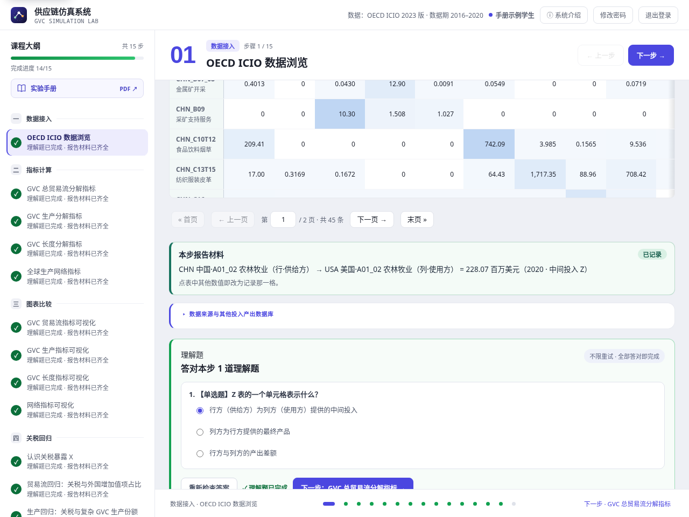

*图 3　2020 年中间投入 Z 表。点击的单元格显示在“已记录的观察值”区域，表中以 ✓ 标出。*

### 这样操作

1. 进入“OECD ICIO 数据浏览”。系统会先默认记录当前表中最大的一格，因此本步材料一开始就已齐全。
2. 选择年份（例如 2020）和“中间投入 Z”，供给国选中国，使用国选美国。
3. 点击一个数值：“已记录的观察值”改为你选的格子，并打开全屏表核对方向。
4. 记录年份、表类型、供给方、使用方和单位。

### 怎样解释

行是供给方，列是使用方。图中 `CHN_A01_02 → USA_A01_02` 的读数约为 228.07 百万美元，表示该年所选行业之间的中间投入，不是两国全部贸易。若读数为 0，应区分有效零值与缺失值；不能把空白当作零。

> **注意**　筛选后的切片只包含完整投入产出表的一部分；切片合计不能直接当成整个经济体总产出。报告会注明单元格是系统默认记录还是你自己选的。

<!-- page -->

## 通用操作：理解检查与保存

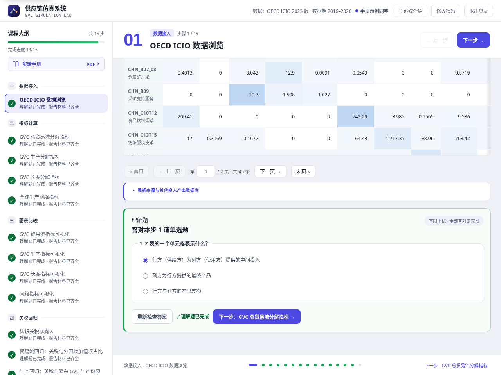

*图 4　每步末尾的理解检查。题目可以重试，全部答对后形成该步的理解完成状态。*

### 提交理解题

1. 阅读题干，结合本步图表和说明选择答案。
2. 点击“提交答案”。回答不正确时，阅读反馈并重新思考。
3. 检查“理解题已完成”，再看任务卡右侧是否为“报告材料：已齐全”。

### 确认操作已经保存

系统在操作停止后约 800 ms 自动保存。出现“重试保存”时先处理，不要关闭页面。

若提示其他标签页已更新，点“载入服务器版本”：另一个标签页改过的内容以它为准，本页的其他修改会自动保留。两边在同一步改了同一处时，本页这一步的修改会被替换，需要的文字先复制到个人笔记。不要反复提交旧内容。未提交的理解题选择只在本次页面内暂存，刷新或退出后不保留。

### 本步小练习

分别回答：Z 表中的一格表示什么？最终需求 Y 与中间投入 Z 有什么区别？负的存货变化是否必然意味着数据缺失？

> **记录要求**　写明对象、年份、指标、数值和单位，便于在报告中引用。

<!-- page -->

## 02　读懂总贸易流分解

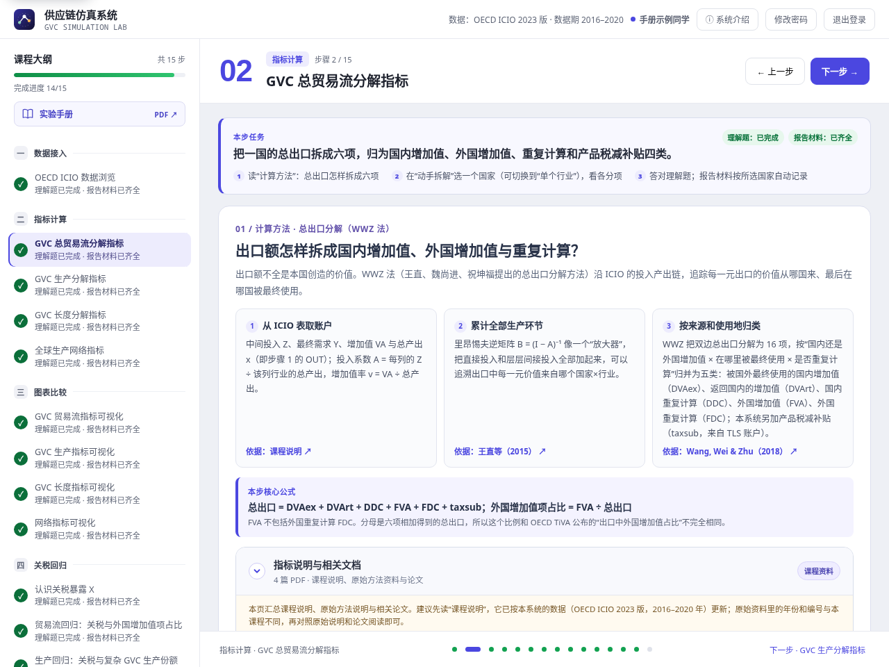

*图 5　步骤 2 先介绍计算方法：从 ICIO 表取账户，累计全部生产环节，再按来源和吸收地归类。*

### 这样操作

1. 阅读“01 / 计算方法”的三步说明和本步代表指标；需要时在“指标说明与相关文档”中阅读课程说明和原始文献。
2. 在“02 / 动手拆解”选择真实国家（默认国家级，可切换到“国家–行业级”），对照各分项的金额、占比与含义。
3. 页面底部“报告材料 · 自动记录”显示所选国家与“对比国家”（默认美国，可在同一行更换）同一年的读数，无需另外保存。勾选“并排对比两个对象”时，对象 B 就是对比国家。
4. 完成理解题。

### 记录与解释

当前 OECD ICIO 课堂数据中，2020 年外国增加值项占比：中国 11.73%，美国 5.51%，中国高约 6.22 个百分点。这只是所选年份和本实验口径下的描述性结构比较，不是国家优劣排名或政策效应。

总出口由 `DVAex、DVArt、DDC、FVA、FDC、taxsub` 闭合；`EXDVA` 是派生项，不再重复相加。

> **记录提醒**　这里观察出口分解中的外国增加值这一项，不含外国重复计算 FDC。更换国家后，报告材料随之更新。

<!-- page -->

## 03　区分四类生产活动

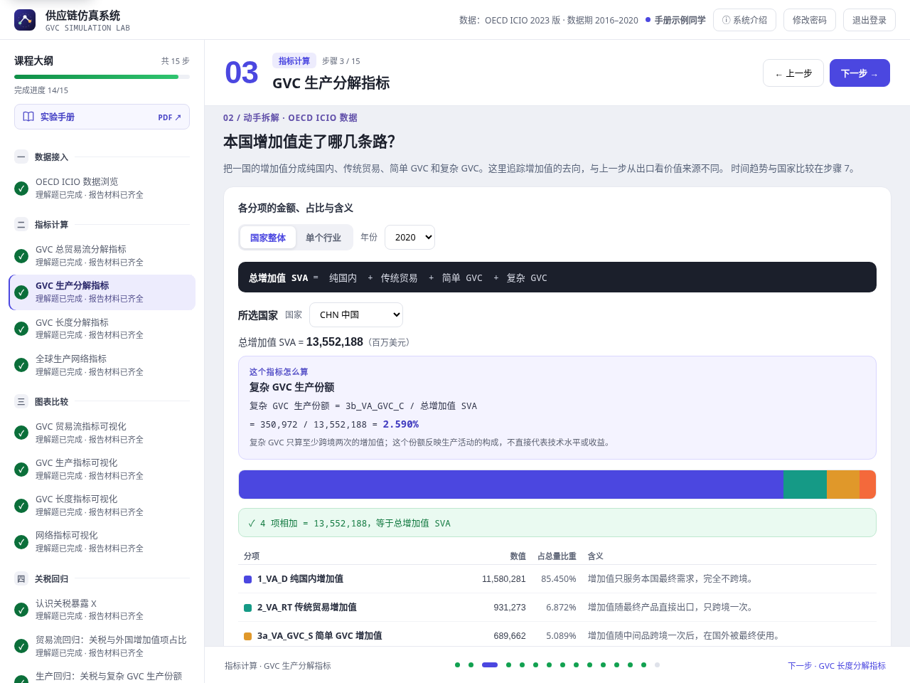

*图 6　“动手拆解”把总增加值分成四类生产活动，并核对四项加总等于 SVA。*

### 这样操作

1. 阅读计算方法中纯国内、传统贸易、简单 GVC 和复杂 GVC 四类活动的定义。
2. 在“动手拆解”选择国家（可切换到“国家–行业级”选行业），查看四项增加值和占比，确认加总与总增加值一致。
3. 报告材料自动记录两国同一年的复杂 GVC 生产份额。
4. 完成理解题。

### 记录与思考

写出两国复杂 GVC 生产份额及年份。四类增加值加总为 SVA；复杂 GVC 份额为复杂 GVC 增加值除以 SVA。

复杂 GVC 至少经历一次中间品跨境，且总跨境次数至少两次；后续跨境可以是最终品贸易。

> **避免混淆**　复杂 GVC 份额高，只说明这类活动在增加值中的构成较高，不能单独说明生产规模更大、供应链更稳健或政策冲击更强。

<!-- page -->

## 04　区分前向与后向生产长度

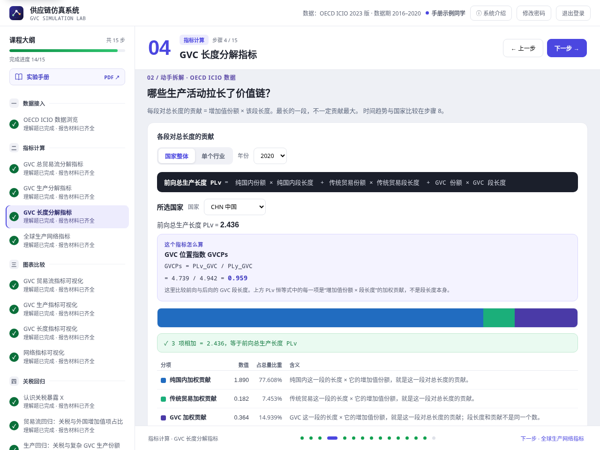

*图 7　长度拆解：每段对总长度的贡献等于增加值份额乘以该段长度。*

### 这样操作

1. 先阅读前向 PLv、后向 PLy 和 GVCPs 的计算方法。
2. 在“动手拆解”选择国家（可切换到“国家–行业级”选行业），查看各段的加权贡献和段长度本身。
3. 报告材料自动记录两国同一年的 GVC 位置指数（GVCPs）。
4. 完成理解题。

### 怎样解释

前向从增加值创造端追到最终吸收；后向从最终产品端回溯初始投入。长度是累计总产出与关联增加值的比值，不是运输距离或日历时间。

`GVCPs = 前向 GVC 长度 / 后向 GVC 长度`。大于 1 表示在该口径下相对更上游。

> **观察任务**　用一句话说明两国谁相对更上游，并补充“按什么指标判断”。不要仅凭该比值给整个国家贴上“资源国”标签。

<!-- page -->

## 05　比较流量规模与网络位置

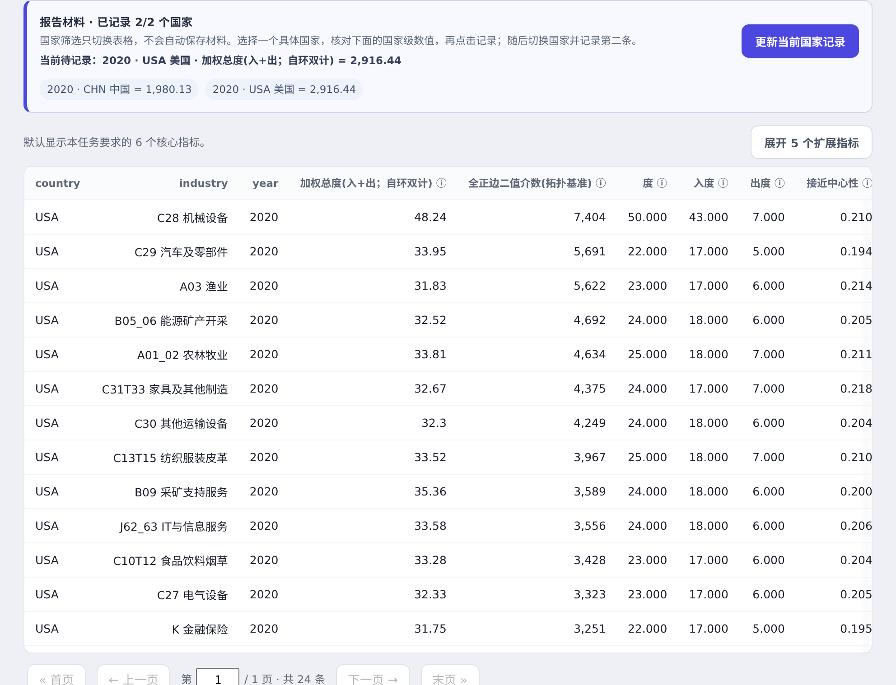

*图 8　行业节点的中心性表。选择一个国家后，可按加权度或介数排序比较。*

### 这样操作

1. 阅读加权度与介数的计算方法；可展开“在一个小网络上看度与介数怎么数”。
2. 在中心性表选择一个国家，切换“加权度降序／介数降序”，比较两种行业排序。
3. 报告材料自动记录两国同一年的加权总度。
4. 记一条行业观察到个人笔记，并完成理解题。

### 怎样解释

加权度衡量流入和流出规模；介数按最短路径经过节点的情况计算。当前路径指标把所有正流量边视为等长，不按金额大小设置距离。

> **观察任务**　找一个加权度和介数排序不一致的行业，说明两种指标回答的是不同问题。国家层网络两两相连，介数都是 0，不能用来证明该国没有经济枢纽作用。

<!-- page -->

## 06　看贸易流的变化与全球位置

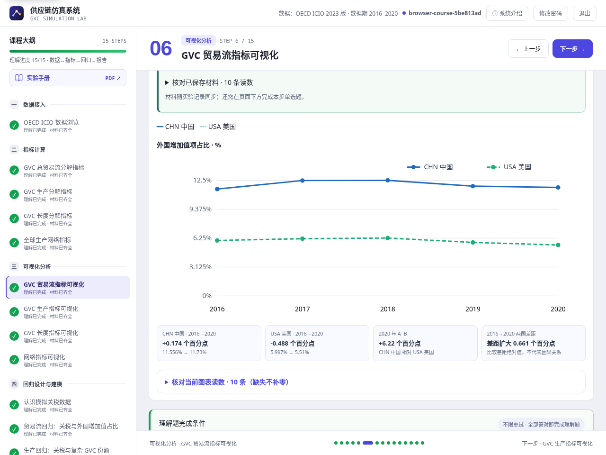

*图 9　所选国家的历年趋势。灰色带是中间 50% 的经济体，虚线是全球中位数；虚线色线是对比国家。*

### 这样操作

1. 打开本步先看“出口构成”：出口中各项增加值来源的构成，可切“占比／金额”；“历年”是逐国的堆叠面积图。
2. 切到“历年变化”选指标和年份区间，对照全球中位数和灰色带看走势；读图下的卡片：本国变化 → 在全部经济体中的排名 → 全球中位数变化 → 与对比国家的差距。
3. 切到“国家对比”看它当年的位置和前 20 排名；“定位图”（总出口对数 × 外国增加值项占比，可切坐标、可叠轨迹）只作探索；“行业结构”按行业逐点比较所选国家。
4. 报告材料自动记录最后查看的完整图表（一国看国家整体，或加入 1–4 个对比国家）；核对已保存材料，再完成理解题。

### 怎样解释

先说本国怎样变化、处在全球什么位置，再与对比国家比较。份额之差用百分点描述；金额为当年价格，跨年变化不等于实际增长。涉及 2020 年时，还要区分现价、疫情期统计外推与实际结构变化（见 OECD TiVA 2023 指南第 42 页），步骤 7–9 同样适用。

> **记录规则**　报告材料是一张读数完整的图：只看一国时用国家整体口径即可记录，也可加入 1–4 个对比国家；选了行业而只看一国时不记录；探索视角不记录。排名只表示相对高低。

<!-- page -->

## 07　看生产分工的变化与全球位置

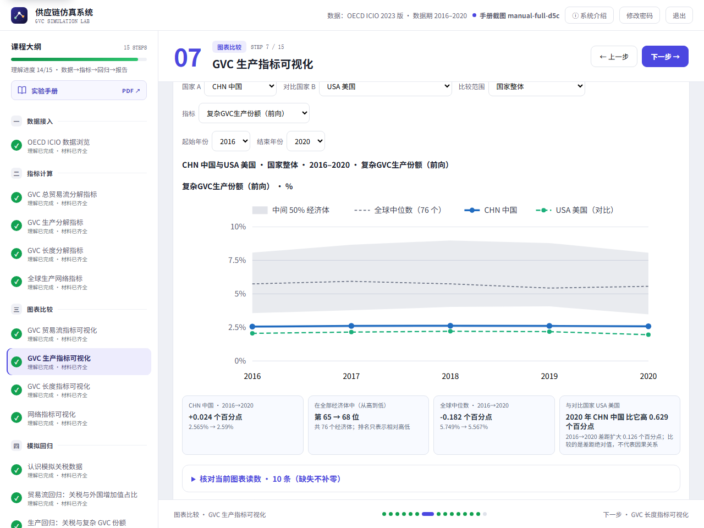

*图 10　复杂 GVC 份额的历年趋势与全球参照。可切换四类生产活动、国家对比或定位行业视角。*

### 这样操作

1. 打开本步先看“四类生产活动”，可切“前向（SVA）／后向（FGY）”和“占比／金额”，“历年”是堆叠面积图；再切到“历年变化”看复杂 GVC 份额，对照全球中位数。
2. 用“国家对比”看排名；“定位图”可切“参与方式／供给侧与需求侧”坐标，只作探索；“行业结构”看各行业四类份额（探索），“定位行业”记录行业读数。
3. 报告材料自动记录最后查看的完整图表（一国看国家整体，或加入对比国家）。
4. 展开已保存材料核对国家、行业和年份，再完成理解题。

### 记录与思考

前向从增加值来源端核算，后向从最终品端回溯，两种分母不能混用。思考：本国高于还是低于全球中位数？国家整体份额是否掩盖了行业差异？

> **避免混淆**　份额变化是构成变化；若要讨论规模，还需要相应金额证据。行业口径只显示所选国家，没有全球参照。

<!-- page -->

## 08　用图判断相对上下游位置

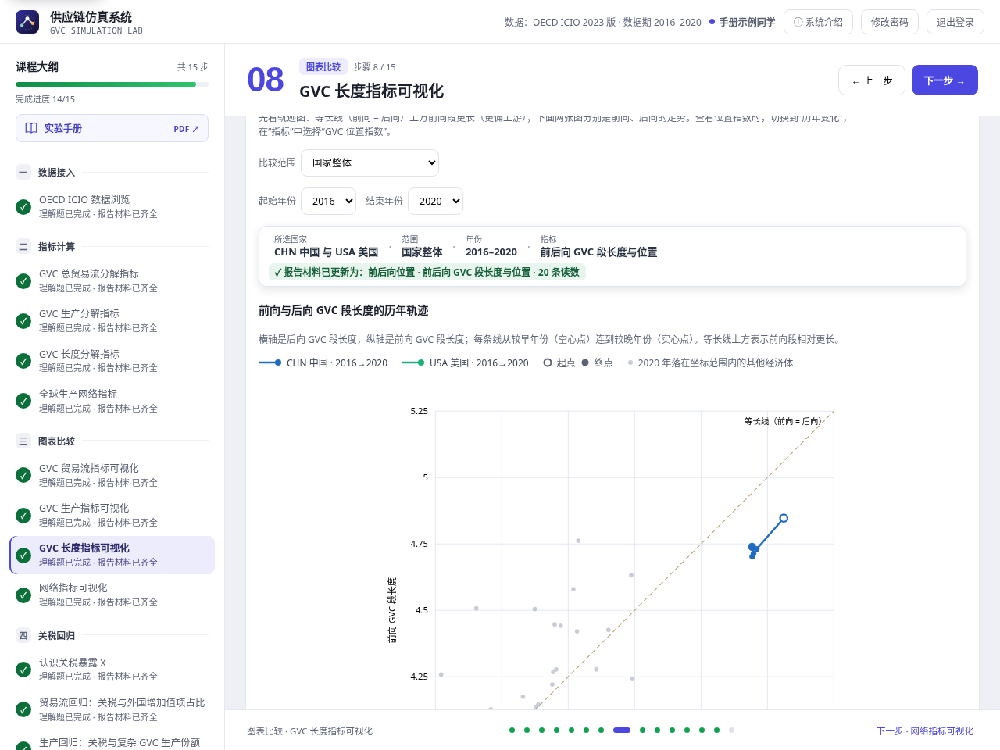

*图 11　前后向位置：所选国家的前向—后向 GVC 段长度轨迹，灰点是当年全部经济体，等长线上方更偏上游；下方是两段长度的历年趋势。*

### 这样操作

1. 在“前后向位置”先看轨迹图：灰点是当年全部经济体，等长线上方前向段更长（更偏上游）；下方是前向、后向 GVC 段长度的历年趋势。
2. 用“段长度对照”看纯国内、传统贸易、GVC 三段的前向与后向长度（哑铃图，记录六项读数）；用“国家对比”看它当年排第几；“行业结构”看各行业的位置散点（只作探索），“定位行业”记录行业读数。
3. 报告材料自动记录最后查看的完整图表，前后向视图同时记录两项长度。
4. 核对已保存读数与单位，完成理解题。

### 记录与思考

长度不是距离或天数；GVCPs 是比值，不能与长度相加。中位数和排名只区分相对高低，不代表好坏。

> **注意**　链长变化不等于企业回流或近岸化。上游活动包括原材料、关键中间品和生产性服务，还需结合行业分析。

<!-- page -->

## 09　看行业网络位置的变化与全球位置

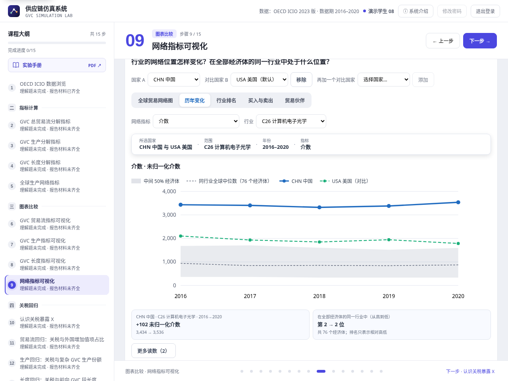

*图 12　一个行业的网络指标历年变化。灰色带和虚线是全部经济体同一行业的中间 50% 和中位数；虚线色线是对比国家。*

### 这样操作

1. 在“历年变化”选网络指标和行业，对照同行业的全球中位数，读卡片中的排名变化。
2. 切到“国家对比”：本国行业按指标降序排列，灰色竖线是该行业的全球中位数，“全球第 N 位”是在全部经济体同一行业中的排名；点击行业查看历年变化；展开“全部指标表”可查本国全部行业的多项指标。
3. 报告材料自动记录最后查看的完整趋势或排名（一国或多国均可）；完成理解题。
4. “流量与拓扑”（各行业的加权总度 × 介数散点）、“买入与卖出”（各行业的加权入度与出度）和“贸易伙伴”（主要伙伴、伙伴集中度、区域流向）只供探索，不记录材料。

### 怎样解释

加权度看流量规模，介数看路径中介位置。先说本国行业怎样变化、在全球同行业中处于什么位置，再与对比国家比较；不把缺失值写成零。

> **必须说明**　本课程介数为全正边、二值、无权、未归一化的探索性拓扑指标，尚未进行边阈值敏感性检验。排名只表示相对高低，不代表经济重要性；国家间网络图不能用来解释行业中心性。

<!-- page -->

## 10　认识关税数据

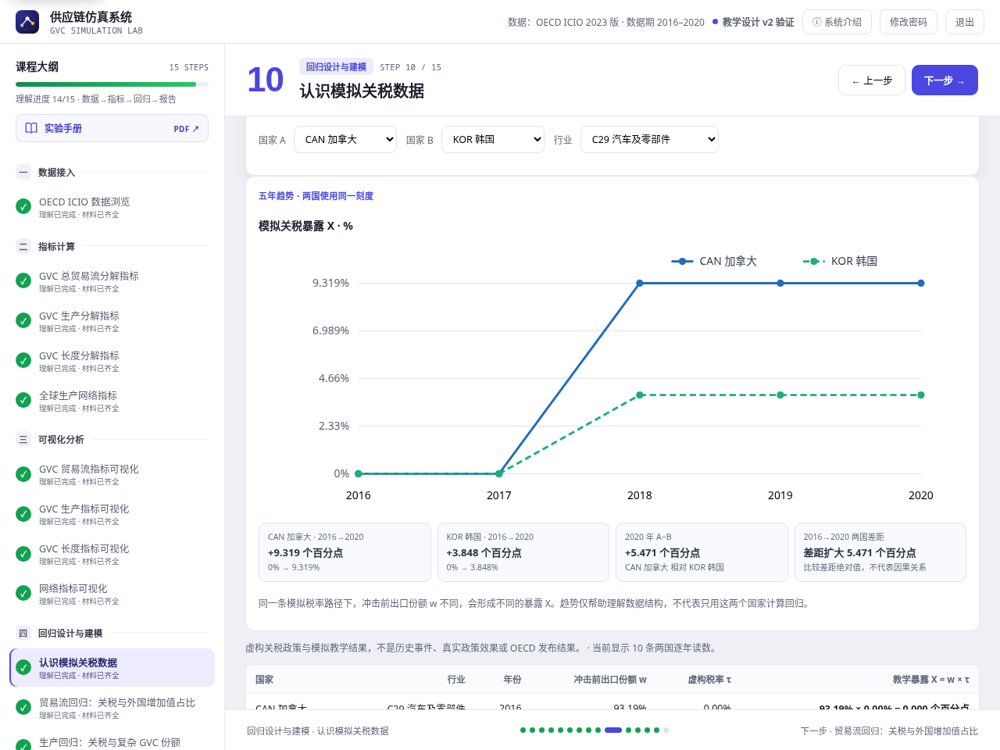

*图 13　跟随的例子：加拿大被加税、墨西哥未加税，两国汽车行业都高度依赖对美出口。图下用你选的那一行算一次 X = w × τ。*

### 这样操作

1. 选一个国家和一个行业作为跟随的例子，可以再选一个对比国家（也可以只看一个加税国家）；默认是加拿大与墨西哥，行业默认沿用你在步骤 9 看的行业（没有记录时为汽车行业）。
2. 看图：被加税的国家从 2018 年起 X 跳起来，未加税的国家一直是 0。图下的算式用你选的例子算一次 w × τ = X；需要逐年读数时展开“两国逐年读数”。
3. 留意样本说明：后续回归使用全部 3,244 个国家×行业单元 × 5 年 = 16,220 条记录，例子只是其中两行。
4. 面板加载后自动记录；完成理解题。

### 怎样解释

X = 固定的冲击前销往美国的出口份额 × 税率。前两年税率为 0；加税的国家后三年统一为 25%，其余国家为 0。例如加拿大汽车行业 w = 93.19%，2020 年 X = 93.19% × 25% = 23.30 个百分点。美国本身是加税市场，它的 w、τ 和 X 都是 0。步骤 11–14 会把回归结果换算到这里选的例子上。

<!-- page -->

## 11　运行贸易流回归

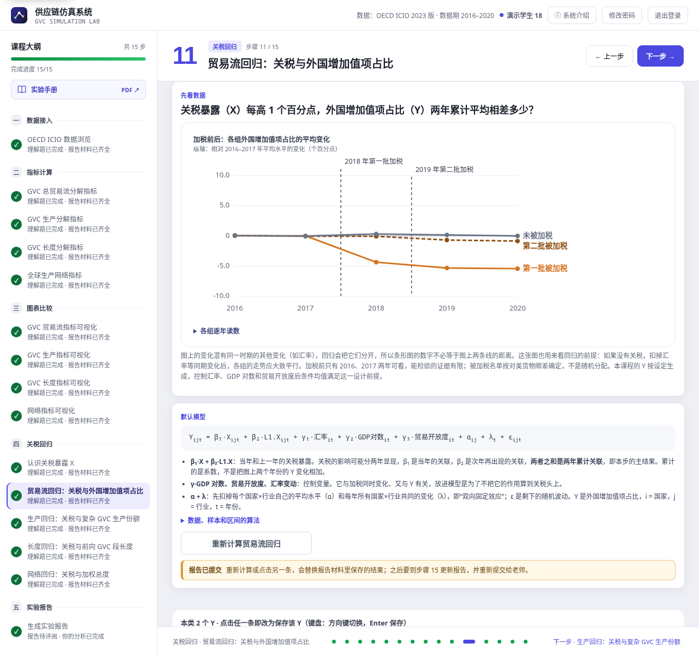

*图 14　运行前先看加税国家组与未加税国家组的平均变化（图为步骤 12，四步页面结构相同）。*

### 这样操作

1. 确认 X 是关税暴露，Y 是本步的结果指标，读数单位见标签。默认 Y 是外国增加值项占比；如果你在步骤 6 看的是同一类的另一个指标（如国内增加值出口占比），这里会默认换成它。“结果指标 Y”下拉也可以手动换成同一类的另一个指标；X、样本和模型都不变，换了之后要重新点一次计算，报告记录你最后算的那一个。
2. 读两组对比图和图下三张读图卡：两条线都减去自身 2016–2017 年平均水平，所以起点都接近 0；2018 年后两线分开的距离就是回归要算的差距。图下常驻本步公式。
3. 点击“算出这个差距（用全部 16,220 条记录）”；已有结果时为“重新算一次”。结果自动保存，算完后图上会用虚线括号标出回归估计的差距。
4. 完成理解题。

### 计算方法

四步都使用同一个最常见的面板回归：Y = β·X + 国家×行业固定效应 + 年份固定效应（双向固定效应，TWFE）。它只比较同一个国家×行业在加税前后的变化，再扣掉所有单元共同的年份变化，β 就是“X 每高 1 个百分点，Y 平均差多少”。系数描述样本中 X 与 Y 的关联。回归使用全部样本（排除 ROW），不限于步骤 10 选的两个例子。

<!-- page -->

## 11　解读回归结果

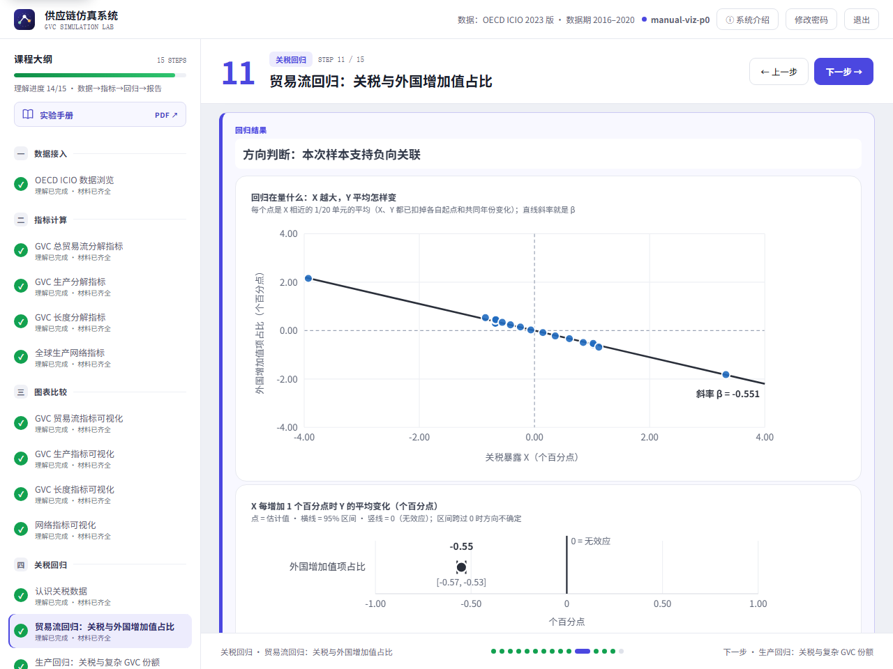

*图 15　上图是分箱散点：每个点是 X 相近的一箱单元的平均（X、Y 都已扣掉固定效应），直线的斜率就是估计值 β。下图是系数图：点为估计值，横线为 95% 区间，竖线为 0。再往下几句话说明结果。*

### 按这个顺序阅读

1. 看分箱散点：点从左上到右下，说明 X 高的单元 Y 平均更低；直线越陡，β 的绝对值越大。
2. 看方向判断与系数图：区间完全在 0 的一侧才支持该方向；跨过 0 时方向不确定。
3. 读第一句：X 每增加 1 个百分点，Y 平均变化多少，以及 95% 区间。
4. 读换算句：估计值乘以你在步骤 10 所选例子的 X，得到该例的约略变化。
5. 需要时展开“系数表与样本（可选）”，查看标准误、p 值和样本说明。

### 怎样写进报告

优先引用结果卡标明的数值与单位；已显示“个百分点”时，不要再次乘以 100。例如 2 个百分点不是增长 2%。95% 区间按国家聚类近似计算；信息集中在少数国家时，实际覆盖率可能低于 95%。

> **图中示例**　关税暴露增加 1 个百分点时，外国增加值项占比平均下降约 0.55 个百分点，95% 区间为 [-0.57, -0.53]；换算到加拿大汽车行业（X = 23.30 个百分点）约下降 12.83 个百分点。数值以你的课堂数据为准。

<!-- page -->

## 12　换成复杂 GVC 生产份额

方法与步骤 11 相同，只把 Y 换为复杂 GVC 份额（如果你在步骤 7 看的是另一类生产活动份额，默认换成它）。本步重点是读区间。四步都可以在“结果指标 Y”下拉里换成同一类的另一个指标，换完重新计算即可。

### 这样操作

1. 确认本步结果变量为复杂 GVC 份额，先读两组对比图。
2. 点击“算出这个差距”（已有结果时为“重新算一次”），结果自动保存。
3. 记录估计值和区间；若无法推断，记录原因。
4. 与步骤 11 比较，完成理解题。

### 记录与思考

生产指标以 SVA 为分母，贸易指标以账户闭合总出口为分母；即使都用百分点，也不是同一个概念。

本版示例：X 增加 1 个百分点，Y 平均变化 −0.37 个百分点，区间为 [−0.39, −0.36]。

> **注意**　估计值为负，不一定有足够证据判断下降，还要看区间是否包含 0。份额变化也不等于产量变化。

<!-- page -->

## 13　换成前向 GVC 生产长度

方法与步骤 11 相同，Y 换为生产长度：默认前向 GVC 长度，如果你在步骤 8 看的是后向长度或位置指数，默认换成它。本步重点是读单位：读数为长度单位，不是百分点。

### 这样操作

1. 确认结果变量为前向 GVC 生产长度（或你在步骤 8 看的指标）。
2. 点击“算出这个差距”；回归使用全部样本，不限于步骤 10 的两个例子。
3. 按长度单位解释结果；若无法推断，记录原因。
4. 与贸易流、生产回归比较，完成理解题。

### 记录与思考

前向 GVC 长度追踪增加值创造端到最终吸收的跨境生产活动。本步系数以长度单位表达，不能按百分点解释，也不能直接和外国增加值项占比的系数相减。

本版示例：X 增加 1 个百分点，Y 平均变化 −0.018 个长度单位，区间为 [−0.019, −0.017]。此处不是 −0.018 个百分点。

> **注意**　长度系数不能与前两步的百分点系数相减或比大小。

<!-- page -->

## 14　运行网络指标回归

方法与步骤 11 相同；Y 是步骤 9 所看的网络指标，默认加权总度（如果你在步骤 9 看的是加权入度、加权出度、介数或接近中心性，默认换成它）。

### 这样操作

1. 确认 Y 为加权总度（或你在步骤 9 看的网络指标）。
2. 点击“算出这个差距”，记录原始单位、标准差换算和区间或诊断。
3. 本步只看网络指标。四个 Y 的系数图并排比较放在步骤 15 的“查看已保存的四项回归结果”：四张图单位不同，只比较方向和区间是否跨 0，不比较数值大小。
4. 完成理解题，准备步骤 15。

### 记录与思考

加权总度是一个国家×行业节点买入与卖出流量之和（自环双计），反映流量规模；介数等路径指标看的是中介位置。两者都不是脱离网络口径的“经济影响力分数”。

本版示例：X 增加 1 个百分点，Y 平均变化 −39.70 个中心性原始单位，区间为 [−40.83, −38.57]。四个 Y 单位不同，不能因为绝对数值较大，就断言网络效应比前三项更大。

> **注意**　网络系数不是政策“总效应”。加权总度与介数的定义见步骤 5、9。

<!-- page -->

## 核对四项回归结果

步骤 15 的“查看已保存的四项回归结果”并排放着四张系数图，并列出步骤 11–14 已保存的结果。回归结果必须来自实际运行，不能用两组对比图代替。

### 这样复核保存结果

1. 确认四步使用同一个模型，只有 Y 不同。
2. 课程模型固定不变（同一个双向固定效应回归），四步只换 Y。
3. 重新运行时记录样本和诊断；不要只摘取看起来更显著的版本。
4. 生成报告前检查最终保存的是哪一套结果。

### 注意方法约束

模型不加控制变量和交互项，也不加入同期的其他指标。步骤 11–14 必须分别实际运行并保存结果；若模型不可估计，则保存服务端返回的完整诊断即可，不要求寻找显著的结果。

> **注意**　系数描述 X 与 Y 的关联；区间跨 0 时不要写成“没有效应”。

<!-- page -->

## 15　撰写分析

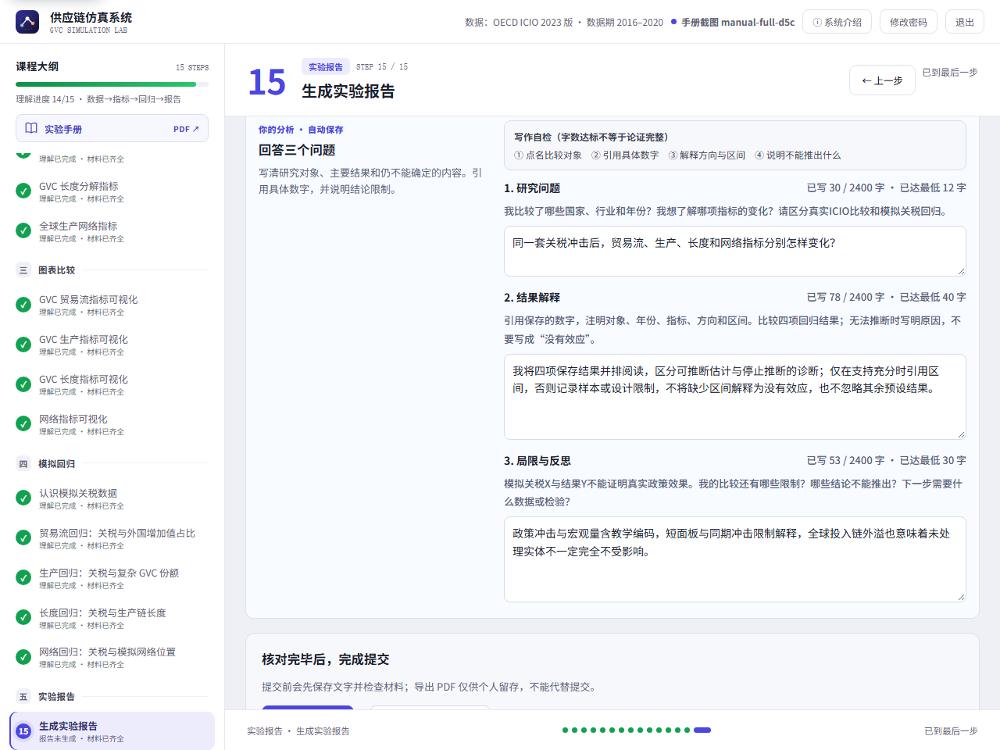

*图 16　原创分析区域。截图文字只示范论证结构，请结合自己的记录独立撰写。*

### 三段文字分别回答什么

- **研究问题**：你比较了哪些国家、行业和年份？想了解哪项指标的变化？至少 12 字符。
- **结果解释**：引用实际对象与数值，说明方向、区间；若无法推断，写明原因。至少 40 字符。
- **局限与反思**：说明样本范围、外溢、同期冲击等限制。至少 30 字符。

输入框里的灰色“句式参考”只作提示，开始输入后消失，不会写进报告。每项最多 2400 字符；达到字数门槛只表示满足最低要求，不自动代表论证完整。

> **写作自检**　对象清楚吗？引用了具体证据吗？设置与结果对应吗？哪些结论尚不能推出？不要把本册示例直接复制为个人分析。

<!-- page -->

## 15　生成并复核实验报告

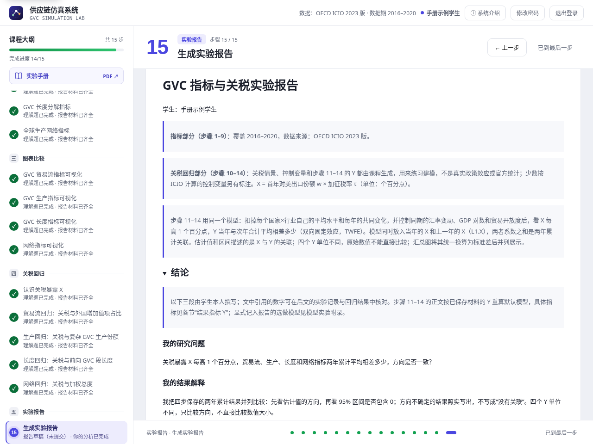

*图 17　根据已保存记录生成的报告正文。阅读时核对版本、来源、材料和计算设置。*

### 这样操作

1. 检查“1 · 检查实验材料”；若有缺项，使用页面提示返回对应步骤。
2. 点击“根据实验记录生成报告”，等待出现草稿状态。
3. 逐段核对年份、国家、观测、四类回归及自己的文字。
4. 检查数据来源说明和无法推断的原因是否与实际结果一致。

### 报告复核清单

确认四类结果都在报告中，没有只保留显著项；没有把中美描述比较当作全样本政策效应；份额、长度和网络单位没有混用。报告会注明哪些材料由系统默认记录。

> **两条入口**　可先生成草稿、复核后提交；也可用页面的“生成并提交报告”一次完成。首次实验建议先预览。只生成草稿，老师仍看不到报告。

<!-- page -->

## 15　提交、查看评语与导出 PDF

*图 18　提交状态区域显示提交时间与“等待教师评阅”。*

*图 19　教师评分后显示分数与评语。90 分仅为流程验证示例。*

### 提交与查看

1. 草稿复核完成后，点击“提交报告给老师”。
2. 确认状态变为“等待教师评阅”，而不是只看按钮是否点过。
3. 教师完成评分后，刷新或再次进入步骤 15 查看反馈。
4. 按教师要求修改或留档。

### 导出个人报告

点击“导出 PDF”，在打印对话框选择“另存为 PDF”并检查分页。按钮不可用时，先读版本提示：修改过材料或文字后，须保存并更新报告。文件名可包含姓名、课程和日期。

> **谨慎更新已评分报告**　重新生成会替换当前报告、清除旧评分与评语并重新提交。已评分报告会先弹出确认；取消保留原报告。需要留档时先导出原稿。

<!-- page -->

## 可打印的个人实验记录表

姓名：________________　学号：________________　日期：________________

### A．原始数据与指标比较

| 项目 | 我的记录 |
| --- | --- |
| 数据年份、表类型 | __________________________________________ |
| 原始表供给方行／使用方列 | __________________________________________ |
| 单元格数值与单位 | __________________________________________ |
| 比较经济体及共同年份 | __________________________________________ |
| 外国增加值项占比：对象一／对象二 | __________________________________________ |
| 复杂 GVC 份额：对象一／对象二 | __________________________________________ |
| PLv_GVC、PLy_GVC 或 GVCPs | __________________________________________ |
| 一条具体行业网络观察 | __________________________________________ |

### B．四类回归记录

| 结果 | 估计与区间 | 换算到我的例子 |
| --- | --- | --- |
| 贸易流 | __________________ | __________________ |
| 生产 | __________________ | __________________ |
| 长度 | __________________ | __________________ |
| 网络 | __________________ | __________________ |

### C．我能解释什么，还不能解释什么

____________________________________________________________________

____________________________________________________________________

____________________________________________________________________

> 留档前核对：已记录年份和单位；已写真实设置；没有遗漏诊断；报告状态符合教师要求。

<!-- page -->

## 常见问题与解释纠错

### 操作问题

| 现象 | 处理方法 |
| --- | --- |
| 题目已答对，报告仍缺材料 | 打开对应步骤并等数据加载完；步骤 11–14 需要点“算出这个差距” |
| 切换国家后材料没变 | 只记录读数完整的图表（一国需国家整体口径，或加入对比国家）；报告提交后浏览不再改动材料，需用“改用当前图表”按钮 |
| 切到“定位图”“流量与拓扑”“买入与卖出”“贸易伙伴”或步骤 7–8 的“行业结构”后材料没变 | 这些是探索视角，不记录材料；切回“历年变化”“国家对比”等记录视角即可 |
| 页面提示重试保存 | 保持页面，检查连接并重试；确认成功后再继续 |
| 提示其他标签页已更新 | 点“载入服务器版本”，本页其他修改会自动保留；两边改了同一处时先复制本页文字 |
| 讲义预览空白 | 点“新标签页打开 PDF”；仍无法打开时联系教师 |
| 回归没有置信区间 | 查看诊断，确认是否样本不足或模型无法估计 |
| 报告生成后老师看不到 | 核对是否已点击提交并显示等待评阅 |

### 三组常见表述

**不宜写：**“系数不显著，所以政策没有影响。”

**区间跨 0 时：**“当前证据看不出方向，不等于没有效应。”

**无法推断时：**“样本或模型不满足推断条件，原因是……”不能把无法检验写成不显著。

**不宜写：**“复杂 GVC 份额更高，所以供应链一定更稳健。”

**可以写：**“多次跨境活动在增加值中的构成更高，韧性还需要其他证据。”

**不宜写：**“我在步骤 10 选了加拿大和墨西哥，所以回归只比较这两国。”

**可以写：**“例子用于理解和换算；回归使用全部 16,220 条记录。”

<!-- page -->

## 完成实验前的最后核对

- [ ] 我能解释原始表的行、列和单位。
- [ ] 我核对过各步自动记录的比较对象和读数。
- [ ] 我区分了贸易份额、生产份额、链长和网络指标。
- [ ] 我记录了关税暴露 X 的组成、单位和数据来源。
- [ ] 四类结果采用的设置和实际样本已写清。
- [ ] 若无法推断，我已写明原因。
- [ ] 原创分析引用了自己的实验记录。
- [ ] 报告已经复核，并达到教师要求的提交状态。

### 常用术语

| 术语 | 本实验中的含义 |
| --- | --- |
| ICIO | 跨国投入产出表，描述国家—行业之间的供给与使用 |
| GVC | 全球价值链，关注增加值如何经过生产与贸易被吸收 |
| 百分点 | 两个百分数之差；从 10% 到 12% 是增加 2 个百分点 |
| TWFE | 双向固定效应；本课吸收国家×行业与年份差异，不自动赋予因果解释 |
| 固定处理前权重 | 用处理前出口结构加权，避免当期结构直接反向决定暴露 |
| 无法推断 | 样本或模型不满足条件，不提供 p 值和区间，但保留数值与原因 |

### 版本与截图说明

截图于 2026 年 10 月 7 日从独立的本地示例课堂拍摄（2.8 版按当前界面重拍全部 19 张图），使用测试账号，不含真实学生资料；学习记录先通过公开接口准备，再由浏览器打开页面截图。各图的代码、数据版本、尺寸和文件指纹见 `docs/student-manual/screenshots.json`。

步骤 1–9 使用 OECD 输入，步骤 10–14 使用课程关税数据。数值以当前课堂数据为准，截图示例不作为作业答案或评分标准。需要了解计算细节、接口或部署方式时，请参阅配套《技术手册》。
