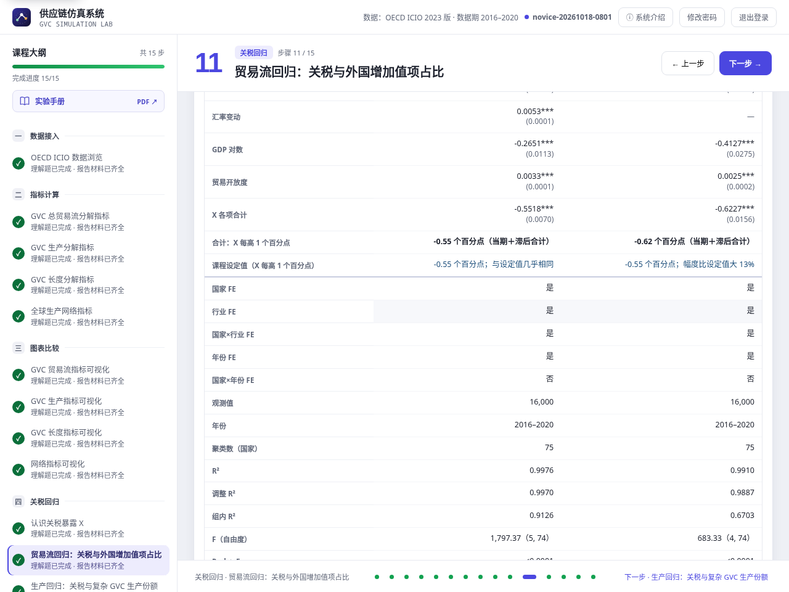

# 实验手册

**基于全球生产网络的国际供应链冲击虚拟仿真系统**

（登录后界面显示的平台名称为“供应链仿真系统”。）

学生操作版 · 15 步图文指南

学习投入产出指标，看指标的变化与全球位置并比较国家，练习关税回归，完成实验报告。

**本册使用方式**

打开系统，按本册的“操作—记录—解释”逐步完成实验。截图用于识别按钮和结果区域；年份、对象和数值以你自己的课堂数据为准。

版本 2.25 · 2026 年 10 月 14 日（教学数据 v13）

> **版本提示**　本册按 `step10-tariff-teaching-v13` 更新。v13 让每一类控制变量与固定效应的改动都明显改变估计：GDP 的混杂与关税同向、开放度的混杂与关税反向、各年有一段所有国家共同的锯齿变化；页面显示每个 Y 的课程设定值，并在走势图下写出回归把第一批的变化拆成哪几部分。截图来源及历史图片范围见末页。精确读数与显著性不是教学保证。

适用于桌面浏览器，建议可视区域宽度 1200 px 以上（最低 1000 px；更窄时页面会提示放宽窗口）。

<!-- page -->

## 使用导航与学习目标

本实验分为五个阶段：数据接入、指标计算、图表比较、关税回归、实验报告；下表第一行“开始实验”是进入第一阶段前的准备，不单独算一个阶段。

| 阶段 | 系统步骤 | 本册页码 | 应形成的材料 |
| --- | --- | --- | --- |
| 开始实验 | 登录、进度说明 | 3–4 | 确认账号、数据年份及材料要求 |
| 数据接入 | 1 | 5–6 | 一个原始单元格读数与理解题 |
| 指标计算 | 2–5 | 7–10 | 所选国家四类指标的分解与读数 |
| 图表比较 | 6–9 | 11–14 | 历年变化、全球位置与对比国家 |
| 关税回归 | 10–14 | 15–22 | 关税暴露 X、上一年的 X、汇率变动、GDP 对数与贸易开放度；四类结果 Y 的两年累计与区间读法；选做的模型实验 |
| 实验报告 | 15 | 23–25 | 分析、报告与提交状态 |
| 复核与留档 | 记录表、常见问题 | 26–28 | 可核对的个人实验记录 |

### 开始前准备

1. 使用老师提供的站点地址、学生账号和密码。不要多人共用同一个账号。
2. 使用桌面电脑；浏览器窗口过窄时，先放大窗口。
3. 预留一份个人笔记，记录年份、对象、指标、数值及解释。
4. 推荐用同一标签页完成实验，减少保存版本冲突。

### 本册示例

步骤 1–9 以中国、美国为示例对象，数据为 OECD ICIO 2023 版的 2016–2020 年数据。步骤 10–14 使用课程按设定生成的关税数据（参照真实指标的量级，用于练习读回归，不是真实政策效应或官方宏观统计）：美国分两批加税（2018、2019 年起），默认回归用关税暴露 X、上一年的 X（L1.X）、汇率变动、GDP 对数与贸易开放度，对照贸易流、生产、长度、网络四类结果 Y。步骤 10 的默认例子为加拿大（第一批被加税）与哥斯达黎加（未被加税）的汽车行业。

> **数据来源**　步骤 1–9 使用投入产出数据及计算指标；步骤 10–14 使用课程关税数据：首年对美出口份额 w 来自 ICIO，税率 τ、汇率变动、GDP、人口增长率、贸易开放度、FDI 和 Y 由课程设定或生成；另有明确标注的 ICIO 派生控制。新增宏观变量不是旧 `macro_*` 占位列。

<!-- page -->

## 登录并认识操作界面

*图 1　学生登录入口。使用老师分配的账号，不在手册中填写或公开密码。*

### 这样操作

1. 输入用户名和密码，点击登录按钮。
2. 每次登录都会先显示系统介绍；需要直接开始时点右上角的 ×（跳过介绍）或按 Esc。
3. 确认右上角显示的是自己的姓名；左侧“课程大纲”列出 15 步，每步下方显示理解题和报告材料状态。理解题答对、材料还没齐全的步骤显示橙色 ✓，两项都完成后变成绿色。
4. 在左侧点击步骤名称，或使用“上一步／下一步”切换。

### 登录后先核对

每步顶部的“本步任务”卡列出要做的事，右侧显示“理解题”与“报告材料”两个状态。页面顶部显示数据期，主体区域用于操作。

> **遇到登录问题**　账号或密码错误时先核对输入；若提示服务暂不可用，稍后重试或联系老师。不要连续重复提交登录请求。

<!-- page -->

## 检查进度与保存状态

*图 2　未完成时，步骤 15 列出待补齐的步骤和返回入口。*

**理解完成**指本步理解题全部答对；**材料齐全**指本步报告材料已记录，大多在操作时自动记录，无需另外保存。

### 报告材料怎样形成

| 步骤 | 系统记录什么 |
| --- | --- |
| 1 | 默认记录一个单元格；点击其他数值改为你选的单元格 |
| 2–5 | 自动记录所选国家当年的代表指标（国家整体） |
| 6–9 | 自动记录最后查看的一张完整图表（1–5 个经济体；步骤 6–8 只有一个经济体时，比较范围须选“国家整体”） |
| 10 | 关税数据加载后自动记录所选的例子 |
| 11–14 | 点“计算…回归”后自动保存本步默认 Y 的结果；点条形图的另一条只在图下看它的读数；选做的模型实验点“放入报告”后写进报告附录（每步一个） |
| 15 | 写完三段分析，生成、复核并提交报告 |

> **完成不等于提交**　“15 步完成”不等于老师已收到报告；最后要确认“等待教师评阅”或“已评阅”。

<!-- page -->

## 01　OECD ICIO 数据浏览 · 记录一个投入产出单元格

*图 3　2020 年中间投入 Z 表。点击的单元格显示在“已记录的单元格”区域，表中以 ✓ 标出。*

### 这样操作

1. 进入“OECD ICIO 数据浏览”。系统会先默认记录当前这一页中最大的单元格，因此本步材料一开始就已齐全。
2. 选择年份（例如 2020）和“中间投入 Z”，供给国选中国，使用国选美国。
3. 点击一个数值：“已记录的单元格”改为你选的单元格，表格放大到全屏，方便核对方向。
4. 记录年份、表类型、供给方、使用方和单位。

### 怎样解释

行是供给方，列是使用方。图中 `CHN_A01_02 → USA_A01_02` 的读数约为 228.07 百万美元，表示该年所选行业之间的中间投入，不是两国全部贸易。若读数为 0，应区分有效零值与缺失值；不能把空白当作零。

> **注意**　本页只显示部分国家和行业；表右侧的“所选列之和”不能直接当成整个经济体的总产出。报告会注明单元格是系统默认记录还是你自己选的。

<!-- page -->

## 通用操作：理解题与保存

*图 4　每步末尾的理解题。题目可以重试，全部答对后该步显示“理解题已完成”，提交按钮旁出现“下一步：…”按钮；页面右上角的“下一步”按钮始终可用。*

### 提交理解题

步骤 1–14 使用教师配置的系统统一题库，每步 1–3 道判断题或单选题（单选 2–4 个选项），默认共 24 题；步骤 15 没有理解题。以页面当前题目为准，不照旧题号或旧答案作答。教师保存改题后，仅被修改步骤的旧答案失效，需要载入最新题目重新作答；其他步骤答案、实验材料和已提交报告保留。未提交的报告草稿需重新生成。

1. 阅读题干，结合本步图表和说明选择答案。
2. 点击“提交答案”。回答不正确时，阅读反馈并重新思考。
3. 检查“理解题已完成”，再看任务卡右侧是否为“报告材料：已齐全”。

### 确认操作已经保存

系统在操作停止后约 800 ms 自动保存。出现“重试保存”时先处理，不要关闭页面。

未保存修改的恢复草稿只放在当前窗口的 sessionStorage，按账号和数据 release 区分；不是跨窗口共享备份，也不是永久本地存档。关窗前确认服务器已保存。

若提示服务器记录与本页版本不一致，自动保存会停止。先把需要保留的文字复制到个人笔记，再确认载入服务器记录；此操作会清除本页草稿，不会自动合并修改。不要反复提交旧内容。未提交的理解题选择只在本次页面内暂存，刷新或退出后不保留。

### 本步小练习

分别回答：Z 表中的一个单元格表示什么？最终需求 Y 与中间投入 Z 有什么区别？负的存货变化是否必然意味着数据缺失？

> **记录要求**　写明对象、年份、指标、数值和单位，便于在报告中引用。

<!-- page -->

## 02　GVC 总贸易流分解指标 · 读懂总贸易流分解

*图 5　步骤 2 先介绍计算方法（取账户、累计全部生产环节、按来源和使用地归类）；下方“动手拆解”只拆所选的一个国家。*

### 这样操作

1. 阅读“01 / 计算方法”的三步说明和本步核心公式；需要时在“指标说明与相关文档”中阅读课程说明和原始文献。
2. 在“02 / 动手拆解”选择国家（默认“国家整体”，可切换到“单个行业”），对照各分项的数值、占总量比重与含义。
3. 页面底部“报告材料 · 自动记录”显示所选国家当年的外国增加值项占比（国家整体），无需另外保存。本步只拆解一个国家；国家间比较在步骤 6–9。
4. 完成理解题。

### 记录与解释

当前 OECD ICIO 课堂数据中，2020 年中国的外国增加值项占比为 11.730%。这只是所选年份、按本课程计算方法得到的描述性结构读数，不是国家优劣排名或政策效应。

总出口由 `DVAex、DVArt、DDC、FVA、FDC、taxsub` 闭合；`EXDVA` 是派生项，不再重复相加。

> **记录提醒**　这里观察出口分解中的外国增加值这一项，不含外国重复计算 FDC。更换国家后，报告材料随之更新。

<!-- page -->

## 03　GVC 生产分解指标 · 区分四类生产活动

*图 6　“动手拆解”把所选国家的总增加值分成四类生产活动，并核对四项加总等于 SVA。*

### 这样操作

1. 阅读计算方法中纯国内、传统贸易、简单 GVC 和复杂 GVC 四类活动的定义。
2. 在“动手拆解”选择国家（可切换到“单个行业”），查看四项增加值和占比，确认加总与总增加值一致。
3. 报告材料自动记录所选国家当年的复杂 GVC 生产份额（国家整体）。
4. 完成理解题。

### 记录与思考

写出所选国家的复杂 GVC 生产份额及年份。四类增加值加总为 SVA；复杂 GVC 生产份额为复杂 GVC 增加值除以 SVA。

复杂 GVC 至少经历一次中间品跨境，且总跨境次数至少两次；后续跨境可以是最终品贸易。

> **避免混淆**　复杂 GVC 生产份额高，只说明这类活动在增加值中的构成较高，不能单独说明生产规模更大、供应链更稳健或政策冲击更强。

<!-- page -->

## 04　GVC 长度分解指标 · 区分前向与后向生产长度

*图 7　所选国家的长度拆解：每段对总长度的贡献等于增加值份额乘以该段长度。*

### 这样操作

1. 先阅读前向 PLv、后向 PLy 和 GVCPs 的计算方法。
2. 在“动手拆解”选择国家（可切换到“单个行业”），查看各段对总长度的贡献和段长度本身。
3. 报告材料自动记录所选国家当年的 GVC 位置指数（GVCPs，国家整体）。
4. 完成理解题。

### 怎样解释

前向从增加值创造端追踪至最终吸收；后向从最终产品端回溯初始投入。长度是累计总产出与关联增加值的比值，不是运输距离或日历时间。

`GVCPs = 前向 GVC 段长度 / 后向 GVC 段长度`。大于 1 表示相对更上游（更靠近原料、零部件一端）。

> **观察任务**　用一句话说明所选国家相对更上游还是更下游，并补充“按什么指标判断”。不要仅凭该比值给整个国家贴上“资源国”标签。

<!-- page -->

## 05　全球生产网络指标 · 比较流量规模与网络位置

*图 8　所选国家行业节点的中心性表，可按加权总度或介数排序比较。*

### 这样操作

1. 阅读加权总度与介数的计算方法；可展开“用小型网络演示度、介数与接近中心性的计算”。
2. 在中心性表选择一个国家，切换“按加权总度从高到低／按介数从高到低”，比较两种行业排序。
3. 报告材料自动记录所选国家当年国家整体的加权总度（全部出口 + 进口，中间品和最终品都算，不含国内流量），它和表中按行业计算的数值不能直接比较。
4. 记一条行业观察到个人笔记，并完成理解题。

### 怎样解释

行业的加权总度是买入与卖出的中间品金额之和，衡量流量规模；介数是经过该行业的最短路线所占比例，对所有节点对求和（未归一化），只看连接、不看金额。

> **观察任务**　找一个加权总度和介数排序不一致的行业，说明两种指标回答的是不同问题。国家层网络两两相连，介数都是 0，不能用来证明该国没有经济枢纽作用。

<!-- page -->

## 06　GVC 贸易流指标可视化 · 看变化与全球位置

*图 9　所选国家的历年趋势。灰色带是中间 50% 的经济体，虚线是全球中位数；虚线色线是对比国家。*

### 这样操作

1. 打开本步先看“出口构成”：出口中各项增加值来源的构成，可切“占比／金额”；“历年构成”是逐国的堆叠面积图。
2. 切到“历年变化”选指标和年份区间，对照全球中位数和灰色带看走势；读图下的卡片：本国变化 → 在全部经济体中的排名 → 全球中位数变化 → 与对比国家的差距。
3. 切到“国家对比”看它当年的位置和前 20 排名；“定位图”（横轴总出口、纵轴外国增加值项占比，可切坐标；选“国家整体”时可叠加历年轨迹）只作探索；“行业排名”按行业逐点比较所选国家。
4. 报告材料自动记录最后查看的完整图表（一国看国家整体，或加入 1–4 个对比国家）；页面会提示“报告材料已更新为：…”，可展开“核对已记录的材料”核对，再完成理解题。

### 怎样解释

先说本国怎样变化、处在全球什么位置，再与对比国家比较。份额之差用百分点描述；金额为当年价格，跨年变化不等于实际增长。涉及 2020 年时，还要区分现价、疫情期统计外推与实际结构变化（见 OECD TiVA 2023 指南第 42 页），步骤 7–9 同样适用。

> **记录规则**　报告材料是一张读数完整的图：只看一国时把比较范围选为“国家整体”即可记录，也可加入 1–4 个对比国家；选了行业而只看一国时不记录；探索视角不记录。排名只表示相对高低。

<!-- page -->

## 07　GVC 生产指标可视化 · 看生产分工的变化与全球位置

*图 10　复杂 GVC 生产份额的历年趋势与全球参照。可切换四类生产活动、国家对比或行业排名视角。*

### 这样操作

1. 打开本步先看“四类生产活动”，可切“前向（按增加值来源）／后向（按最终品）”和“占比／金额”，“历年构成”是堆叠面积图；再切到“历年变化”看复杂 GVC 生产份额，对照全球中位数。
2. 用“国家对比”看排名；“定位图”可切两组坐标（简单与复杂 GVC 生产份额／前向与后向 GVC 生产总份额），只作探索；“行业结构”看各行业四类份额（探索），“行业排名”记录行业读数。
3. 报告材料自动记录最后查看的完整图表（一国看国家整体，或加入对比国家）。
4. 展开已保存材料核对国家、行业和年份，再完成理解题。

### 记录与思考

前向从增加值来源端核算，后向从最终品端回溯，两种分母不能混用。思考：本国高于还是低于全球中位数？国家整体份额是否掩盖了行业差异？

> **避免混淆**　份额变化是构成变化；若要讨论规模，还需要相应金额证据。选了单个行业时只显示所选国家，没有全球参照。

<!-- page -->

## 08　GVC 长度指标可视化 · 判断相对上下游位置

*图 11　前后向位置：所选国家的前向—后向 GVC 段长度轨迹，灰点是当年落在坐标范围内的其他经济体，等长线上方更偏上游；下方是两段长度的历年趋势。*

### 这样操作

1. 在“前后向位置”先看轨迹图：灰点是当年落在坐标范围内的其他经济体，等长线上方前向段更长（更偏上游）；下方是前向、后向 GVC 段长度的历年趋势。
2. 用“历年变化”查看单项指标的走势并对照全球中位数（例如在“指标”中选择“GVC 位置指数”）；“定位图”把当年全部经济体按后向（横轴）与前向（纵轴）GVC 段长度画成散点，只供探索，不记录报告材料。
3. 用“段长度对照”看纯国内、传统贸易、GVC 三段的前向与后向长度（哑铃图，记录六项读数；国家整体上纯国内段与传统贸易段的前后向长度相等，这是恒等关系）；用“国家对比”查看其当年排名；“行业结构”看各行业的位置散点（只作探索），“行业排名”记录行业读数。
4. 报告材料自动记录最后查看的完整图表，前后向视图同时记录两项长度。
5. 核对已保存读数与单位，完成理解题。

### 记录与思考

长度不是距离或天数；GVCPs 是比值，不能与长度相加。中位数和排名只区分相对高低，不代表好坏。

> **注意**　链长变化不等于企业回流或近岸化。上游活动包括原材料、关键中间品和生产性服务，还需结合行业分析。

<!-- page -->

## 09　网络指标可视化 · 看行业网络位置的变化

*图 12　一个行业的网络指标历年变化。灰色带和虚线是全部经济体同一行业的中间 50% 和中位数；虚线色线是对比国家。*

### 这样操作

1. 在“历年变化”选网络指标和行业，对照同行业的全球中位数，读卡片中的排名变化。
2. 切到“行业排名”：本国行业按指标从高到低排列，灰色竖线是该行业的全球中位数，“全球第 N 位”是在全部经济体同一行业中的排名；点击行业查看历年变化；展开“全部指标表”可查本国全部行业的多项指标。
3. 报告材料自动记录最后查看的完整趋势或排名（一国或多国均可）；完成理解题。
4. “流量与路径”（横轴加权总度、纵轴介数的行业散点）、“买入与卖出”（各行业的加权入度与出度）和“贸易伙伴”（主要伙伴、伙伴集中度、区域流向）只供探索，不记录报告材料。

### 怎样解释

加权总度看流量规模，介数看经过该行业的最短路线所占比例（对所有节点对求和）。先说本国行业怎样变化、在全球同行业中处于什么位置，再与对比国家比较；不把缺失值写成零。

> **必须说明**　本课程的介数只看连接、不看金额（每条供货关系视为等长），也没有按网络大小归一化。排名只表示相对高低，不代表经济重要性；国家之间的网络图不能用来解释行业中心性。

<!-- page -->

## 10　认识关税暴露 X

*图 13　步骤 10 的逐年表：加拿大（第一批被加税）与哥斯达黎加（未被加税）汽车行业的 X、L1.X 和汇率变动。*

### 这样操作

1. 读“美国对哪些国家加征关税？”：美国分两批对 2016 年对美货物顺差 ≥ 10 亿美元的 37 国的货物（ICIO 行业 A–C）加征 25% 关税：顺差 ≥ 100 亿美元的 14 国 2018 年起（第一批），其余 23 国 2019 年起（第二批）；服务业不加税，另外 38 国未被加税。美国是加税方，不在样本中。
2. 读“回归要用到的变量”：关税暴露 X = w × τ；上一年的 X（L1.X）；汇率变动（本币兑美元的年变动，负为贬值）、GDP 对数与贸易开放度。w 来自 ICIO，τ 由课程设定，宏观控制由课程生成。
3. 在“举例”中选例子国家、对照国家（可选）和行业，看 X、汇率变动的趋势图和逐年表。默认是加拿大与哥斯达黎加的汽车行业 C29；例子自动记录，步骤 11–14 会把结果换算到它上面。
4. 看“37 个被加税国家的 X（从高到低）”：每条是一国 2020 年各货物行业的平均 X（最高加拿大 16.52，最低斯洛伐克 0.54 个百分点），两种橙色区分两批；悬停或用方向键读数，“75 国读数表”列出全部国家。完成理解题。

### 怎样解释

w 是这个国家×行业 2016 年对美出口占其出口总额的比例，固定在加税前，加税后的出口结构不会反过来改变 X。第一批货物行业 2018 年起 τ = 25%，第二批 2019 年起，此前和服务业都为 0。谁被加税、属于哪一批由 ICIO 数据按规则决定，不是随机抽取。两国汽车行业 w 为 93.19% 和 72.93%，只有加拿大被加税：2018 年起 X = 93.19% × 25% = 23.30 个百分点，L1.X 到 2019 年才是 23.30；哥斯达黎加 X 始终为 0。加拿大 2018 年起每年的汇率变动都约 −8 个百分点（本币逐年贬值），GDP 增长更快、贸易开放度上升更多，这些都与加税同时出现，所以默认模型把它们放进控制变量。回归使用全部 16,000 条记录，不只这两个例子。

<!-- page -->

## 11　贸易流回归：关税与外国增加值项占比

*图 14　v12 步骤 11 的“先看数据”与默认模型；student18 已算过，按钮显示“重新计算贸易流回归”。四步结构相同。*

### 这样操作

1. 读“先看数据”：三条线都减去各自 2016–2017 年的平均水平，两条竖虚线标出 2018、2019 年两批加税。图上的变化还混有同期的其他变化（如汇率），回归会把它们分开，所以条形图的数字不必等于两线的距离。算过默认模型后，图下会多一句拆分：第一批 2020 年比加税前变了多少，其中与关税 X 相关的、与汇率变动同步的、与 GDP 和开放度同步的各约多少，其余是三组共同的年份变化与噪声；结论句里的估计只对应“与关税 X 相关”的那一部分。这张图也用来看回归的前提：如果没有关税，扣掉汇率等同期变化后各组走势应大致平行；加税前只有 2016、2017 两年可看，能检验的证据有限。
2. 读“默认模型”的方程和三条说明；需要时展开“数据、样本和区间的算法”。
3. 点“计算贸易流回归（用全部 16,000 条记录）”：本步每个 Y 各画一条（外国增加值项占比、国内增加值出口占比），保存的是本步默认的外国增加值项占比。点击另一条，图下显示它的读数；结论句和报告材料仍是默认 Y。
4. 读条形图和结论句（见下页），完成理解题；理解题下方折叠着选做的“改模型、对比”（见第 18 页）。

### 计算方法

四步都用同一个默认模型：Y = β₁·X + β₂·L1.X + γ₁·汇率变动 + γ₂·GDP 对数 + γ₃·贸易开放度 + 国家×行业固定效应 + 年份固定效应（双向固定效应），标准误按国家聚类。固定效应扣掉每个国家×行业自己的平均水平和每年的共同变化（课程数据里各年有一段所有国家共同的锯齿变化，只有年份固定效应能扣掉它）；汇率、GDP 对数与开放度既与 X 同时变化、又与 Y 有关，控制它们是为了不把其作用算到关税头上：课程数据里汇率贬值和 GDP 增长把 Y 推向与关税相同的方向（漏掉会高估），开放度上升推向相反方向（漏掉会低估）。关税的影响可能分两年显现：β₁ 是加税当年的关联，β₂ 是次年再出现的关联，两者之和 β₁ + β₂ 是“两年累计”关联，即本步主结果，读作“X 每高 1 个百分点，Y 两年累计平均高或低多少”。它描述关联，不是因果。默认四类回归仍用全部 16,000 行、75 国，不限于步骤 10 的例子；四步只换 Y。

<!-- page -->

## 11–14　读懂回归结果（四步通用）

*图 15　步骤 11 运行后：条形图每个 Y 一条（红为正、蓝为负、灰为方向不确定），下面是两年累计的结论句。*

### 按这个顺序阅读

1. 看条形图：区间完全在 0 的一侧时条为红或蓝，方向明确；包含 0 时为灰色。步骤 11–12 以个百分点计；步骤 13–14 条长换算成个标准差，条末先写原单位的值。标“已保存”的是本步默认的 Y，也是报告用的 Y；点其他条只看读数，不改变保存的结果。
2. 读结论句：X 每高 1 个百分点，Y 两年累计平均高或低多少，后面是方向和 95% 区间。“其中当年……，次年再……”是 β₁ 和 β₂ 的拆分，相加等于两年累计（末位可能差 1）。下一行是**课程设定值**：课程数据生成时给这个 Y 定的两年累计，以及你的估计离它多远、区间是否包含它——设定对了的模型应落在设定值附近。后向复杂 GVC 份额设定为 0，GVC 位置指数没有单一设定值。
3. 黄色提示：Y 由课程按设定生成，关联有意设得清晰。下面是步骤 10 例子的换算（显示的两年累计估计值 × 例子的 X，是关联，不是关税造成的变化）和解释限制。
4. 完整系数表（标准误、观测值、R² 等）在理解题下方展开“改模型、对比（选做）”后的结果表里，第一列就是默认模型。

### 怎样写进报告

引用结论句的数值与单位，写明是“两年累计”；已写“个百分点”时不要再乘 100，2 个百分点不是 2%。标准误按国家聚类，采用 CR1 小样本修正，计入全部固定效应（FE）的精确秩；与 reghdfe／fixest 的默认值可能不同。结果主要由少数国家决定时，95% 区间可能偏窄；无法可靠推断时，标准误、p 值和区间一并隐藏，照实记录原因。

> **图中示例**　外国增加值项占比两年累计平均低 0.55 个百分点，95% 区间 [−0.57, −0.54]，当年 −0.33、次年再 −0.22。图中已存例子是中国农业，X = 2.43，换算 −1.34 个百分点；图 13 的加拿大汽车业另可手算 −0.55 × 23.30 = −12.82。两者不是同一个例子。

<!-- page -->

## 11–14　改模型、对比（选做）

*图 16　v12 系数表摘录：默认模型与已保存的“L2国家年份吸收”模型。后者加入 L2.X 和国家×年份 FE，宏观控制被吸收，并非漏汇率试算。*

### 这样操作

1. 在理解题下方展开“改模型、对比（选做）”。先点一个预设实验，每个只改默认模型的一处，分两档：必看——去掉汇率变动、去掉 GDP 对数、去掉贸易开放度；进阶——只放当期 X、去掉年份固定效应、固定效应改为国家 + 行业 + 年份、加上人口增长率和 FDI 净流入占比。点一下就开始计算。结果表的“课程设定值”一行写出每列估计离设定值的偏差（+ 为幅度偏大、− 为偏小）。
2. 因变量默认是本步的 Y，可在“因变量”下拉里换成本步家族里的另一个指标（例如步骤 11 换成国内增加值出口占比）：表中第一列随之换成该指标上的默认模型，“课程设定值”一行按该指标的设定值计算。新结果作为“本次：…”列排在默认模型旁；“合计：X 每高 1 个百分点”一行把 X 各项之和换成本步单位，并注明覆盖“仅当年／两年累计／三年累计”。要自己组合设定，展开“自定义设定”：可选 X、L1.X、L2.X；8 个控制变量各可选当期或滞后 1 期；可选五种固定效应；核对方程后点“计算这个模型”。
3. 需要写进报告时点“把“……”放入报告”：每步只放一个，再算一个模型可点“替换”，不需要时点“移出报告”。放入报告的模型写进报告附录“模型实验”，名称就是预设实验的名称（自己组合的设定写作“自定义设定”，设定内容另列），换了指标的实验连同指标一起记录，附录那张表就在该指标上、第一列是它的默认模型；生成报告时按保存的设定重新计算。
4. “单模型详细数字”默认展开：变量、系数、标准误、t 值、p 值、显著性、95% 区间，下方是观测值、F、Prob > F、R²、调整 R²、Root MSE，可“导出 CSV”；“恢复默认设定”改回默认模型。改模型不影响本步保存的结果。

### 怎样解释

去掉一个控制变量后 X 各项合计明显变化，在本课程设计中用于观察遗漏变量偏误：去掉汇率变动或 GDP 对数会高估（它们与关税同向），去掉贸易开放度会低估（与关税反向），去掉年份固定效应会低估（三组共同的锯齿变化被算到 X 上）。加入无关变量后几乎不变可用于观察无关控制，但不能仅凭一次系数变化断言真实变量是否影响 Y。有三种改动按设计几乎不改变 X 的合计，页面的设定说明写明了原因：加上人口增长率或 FDI（它们与 Y 无关）、加上两年前的 X（数据里没有两年后的关联）、改用国家×年份固定效应（它吸收了全部国家层面的控制变量，吸收不等于没有控制）。人口增长率与 FDI 不进入生成 Y，作为无关控制教学，不保证每次不显著。国家×年份 FE 会在缺失删除前吸收所有宏观控制（包括滞后项），保留“（省略）”及原因，不因这些项删样本；其他未被吸收的控制选滞后 1 期仍从 2017 年开始，因为没有 2015 数据。X 的滞后按税率表生成，不因此少样本。

GDP 对数是 ln（模拟 GDP，美元），首年以 ICIO 国家增加值规模校准；开放度是模拟进出口总额 / GDP（%）；人口增长率独立生成，FDI 是模拟净流入 / GDP（%，可负）。ICIO 增加值对数只是 GDP 代理；出口强度不是开放度。生成公式见技术手册，位置指数另由两项模拟长度相除。

**判断设定，不只看显著性：** 汇率只取滞后 1 期替代不了当期汇率，高估幅度与漏掉汇率相近；错误设定也能显著；漏掉 X 或 L1.X 后，L2.X 可能承接遗漏项，不能据此证明两年后效应。不强求 GDP、开放度、人口或 FDI 显著。通过数值核对不等于设定正确；标准库对照方法见技术手册。

> **注意**　每分钟能算的新模型有上限（页面会写明，默认 20 个）；仍在服务器缓存中的设定不计次，缓存清除后重算仍计次。超过时按钮旁显示倒计时，未缓存的设定要等倒计时结束。报告提交后再放入、替换或移出报告里的模型，要到步骤 15 更新报告；报告数字由服务器按模型设定计算，不采用浏览器快照中的数字。

<!-- page -->

## 12　生产回归：关税与复杂 GVC 生产份额

方法与步骤 11 相同，只换 Y：本步一次画出 7 个生产份额，默认保存复杂 GVC 生产份额。重点是读一个包含 0 的区间。

### 这样操作

1. 先读“先看数据”的三组走势，再点“计算生产回归”（已有结果时为“重新计算生产回归”）。
2. 记录标“已保存”那一条的两年累计估计值和区间。
3. 按任务找到灰色的“后向复杂 GVC 生产份额”，把鼠标停在上面（或用方向键选中）读它的区间，不必点击。点了哪一条，报告就保存哪一条；保存的不是默认指标时，图旁会显示“恢复默认”。
4. 选做：在“改模型、对比”里去掉或加入一个控制变量，看 X 各项合计是否变化。与步骤 11 比较，完成理解题。

### 记录与思考

当前 release 的复杂 GVC 生产份额两年累计约 −0.39 个百分点；后向复杂 GVC 生产份额约 +0.0065 个百分点，区间包含 0。具体区间与当年／次年拆分以页面为准；方向不确定，只能说看不出一致的高低差异。

纯国内、传统贸易、简单 GVC、复杂 GVC 四项份额合计 100%，所以这四条相加约为 0；前向 GVC 生产总份额 = 简单 + 复杂。生产指标以 SVA 为分母，贸易指标以总出口为分母；同为百分点，也不是同一个概念。

> **注意**　区间包含 0 不等于“没有关联”。份额变化也不等于产量变化。

<!-- page -->

## 13　长度回归：关税与前向 GVC 段长度

方法与步骤 11 相同，Y 换成 3 个指标：前向 GVC 段长度（默认）、后向 GVC 段长度和 GVC 位置指数。两项段长度用长度单位、位置指数无量纲，条长都换算成个标准差。

### 这样操作

1. 点“计算长度回归”，看 3 条的方向和区间。
2. 按结论句读已保存那一条的原单位：段长度用长度单位，GVC 位置指数是比值（无量纲），都不是百分点。
3. 选做：在“改模型、对比”里换一种固定效应（例如只勾国家、行业、年份，不勾国家×行业），看结果怎样变。与贸易流、生产回归比较方向，完成理解题。

### 记录与思考

前向 GVC 段长度追踪增加值从创造端到最终使用所经过的 GVC 生产环节；1 个长度单位约等于平均多经过 1 个生产环节，不是跨境次数。

旧 v10 换算示例（非当前精确区间）：前向 GVC 段长度两年累计约 −0.0182 个长度单位，加拿大汽车行业约 −0.0182 × 23.30 = −0.424。这里不是百分点。标准差指扣除国家×行业自身水平和各年共同变化后 Y 的起伏；当前估计与区间以页面为准。

v12 的回归用位置指数逐行等于模拟 PLv_GVC / PLy_GVC，不再独立线性生成，没有预设恒定 β。比值回归的系数是样本线性投影，不能用两项长度系数相除得到，也不能把线性模型中的“两年累计”直接当作比值的真实恒定效应。

> **注意**　长度估计值不能与前两步的百分点估计值相减或直接比较大小。

<!-- page -->

## 14　网络回归：关税与加权总度

方法与步骤 11 相同，Y 换成 5 个网络指标：加权总度（默认）、加权入度、加权出度、介数和接近中心性。单位不同，条长都换算成个标准差。

### 这样操作

1. 点“计算网络回归”，看 5 条的方向和区间。
2. 记录已保存那一条的原始单位、标准差换算和 95% 区间；没算出估计值时记录页面给出的原因。
3. 选做：在默认模型里加入两年前的 X（L2.X），再试只保留 L2.X；比较区间和设定，检查遗漏 X、L1.X 后是否产生显著的替代关联。完成理解题，准备步骤 15。

### 记录与思考

在步骤 5、9 中，加权总度是一个国家×行业买入与卖出的中间品金额之和（行业卖给自己的部分在两边各计一次），看流量规模；介数看中介位置。本步的 Y 是课程按真实加权总度等指标的排名校准生成的数值，单位是“中心性原始单位”，读法相同，但不是百万美元金额。两者只在这张网络里有意义，不是通用的“经济影响力分数”。

旧 v10 换算示例（非当前精确区间）：加权总度两年累计约 −40.43 个中心性原始单位，加拿大汽车行业约 −40.43 × 23.30 = −942。当前估计与区间以页面为准，不能因为数字大就说关联更强。在保留真 X 项的模型中，加入 L2.X 后若区间包含 0，只能说没有证据显示额外关联，不能证明没有关联。

> **注意**　网络估计值不是政策“总效应”。加权总度与介数的定义见步骤 5、9。

<!-- page -->

## 核对四项回归结果

步骤 15 的“四步回归结果”先画一张 4 条的条形图：每步保存的 Y 一条，都换算成个标准差，条末先写原单位的值；下面“比较方向、不确定性和单位”表列出方向、两年累计估计值、其中当年／次年、95% 区间和解释限制；“你的模型实验”表列出你在各步“改模型、对比”中放入报告的模型（每步最多一个），并与默认模型对照。生成的报告同样有每步的条形图、这张汇总图和技术附录系数表；放入报告的模型另见附录“模型实验”。

### 这样复核保存结果

1. 四步用同一个默认模型，只换 Y；每步保存的是标“已保存”的那一条。
2. 图下写“还没计算”的步骤，回到该步点计算按钮。
3. 重新计算或点击另一条都会替换保存的结果；报告提交后再改，要到步骤 15 更新报告。
4. 每步最多把一个模型实验放入报告：在“改模型、对比”里算出后点“放入报告”，再算一个可替换，不需要时点“移出报告”。四步的报告材料固定为各步默认 Y 的默认模型结果；放入报告的模型实验可以在本步家族的另一个指标上，附录会注明。

### 注意方法约束

默认模型控制同期的汇率变动、GDP 对数与贸易开放度，不加交互项。原始数值单位不同，不能直接比较；标准差换算只用于并列比较。Y 由课程生成，多数关联有意设得清晰，但位置指数是两项模拟长度的比值，不能假设它有恒定线性效应；后向复杂生产份额也无预设关税关联。控制相关同期变化后的平行趋势是线性生成设计的前提，不证明真实数据或所有自设模型满足它。不要只挑方向明确的结果；没算出估计值时，保存原因。

> **注意**　估计值描述 X 与 Y 的关联；区间包含 0 时不要写成“没有关联”，只能说方向不确定。

<!-- page -->

## 15　生成实验报告 · 写你的分析

*图 17　“你的分析”区域：回答三个问题。截图文字只示范论证结构，请结合自己的记录独立撰写。*

### 三段文字分别回答什么

- **研究问题**：你比较了哪些国家、行业和年份？想了解哪项指标的变化？请区分指标比较和关税回归。至少 12 字。
- **结果解释**：引用实际对象与数值，说明方向、区间；比较四项回归的两年累计结果；若没算出估计值，写明原因。改过模型时，写明改了什么、X 各项合计怎样变、为什么。至少 40 字。
- **局限与反思**：说明样本范围、外溢、同期冲击等限制，以及模型设定（控制变量、固定效应、滞后期）会怎样影响结论。至少 30 字。

输入框里的灰色“句式参考”只作提示，开始输入后消失，不会写进报告。每项最多 2400 字；达到字数门槛只表示满足最低要求，不自动代表论证完整。

> **写作自检**　对象清楚吗？引用了具体证据吗？设置与结果对应吗？哪些结论尚不能推出？不要把本册示例直接复制为个人分析。

<!-- page -->

## 15　生成实验报告 · 生成并复核

*图 18　student18 已有 v12 报告的开头：标题、学生和数据说明。默认模型控制汇率变动、GDP 对数与贸易开放度；之后是分析、图表、技术附录与学生模型。*

### 这样操作

1. 检查“1 · 检查实验材料”；若有缺项，使用页面提示返回对应步骤。
2. 点击“只生成草稿（不提交）”，页面会自动跳到草稿预览。材料或理解题还没齐时，按钮旁会说明还差几项，点击会跳到缺项清单。
3. 逐段核对年份、国家、观测、四类回归（每步条形图、四步汇总图和技术附录系数表）、附录“模型实验”（放入了模型时才有）及自己的文字。
4. 检查数据来源说明和没算出估计值的原因是否与实际结果一致。

### 报告复核清单

确认四类结果都在报告中，没有只保留显著项；没有把步骤 1–9 的国家描述比较当作关税回归的结果；份额、长度和网络单位没有混用；引用的数字写明是两年累计。报告会注明哪些材料由系统默认记录。

> **两条入口**　可先生成草稿、复核后提交；也可用页面的“生成并提交报告”一次完成。首次实验建议先预览。只生成草稿，老师仍看不到报告，侧栏“完成进度”也要在提交后才计入第 15 步。提交后再修改：完成进度仍计入第 15 步，步骤 15 显示“报告需更新”，老师的名单上也会注明“学生之后改过记录，未重新提交”；点“更新报告并提交给老师”会按最新记录重新生成并再次提交；已提交的报告不能只生成草稿，更新前老师看到的仍是原来提交的版本。

<!-- page -->

## 15　生成实验报告 · 提交、查看评语与导出 PDF

*图 19　提交状态区域显示提交时间与“等待教师评阅”。*

*图 20　老师评分后显示分数与评语。90 分仅为流程验证示例。*

### 提交与查看

1. 草稿复核完成后，点击“提交报告给老师”。
2. 确认状态变为“等待教师评阅”，而不是只看按钮是否点过。
3. 老师完成评分后，刷新或再次进入步骤 15 查看反馈。
4. 按老师要求修改或留档。

### 导出个人报告

点击“导出 PDF”，在打印对话框选择“另存为 PDF”并检查分页。按钮不可用时，先读版本提示：修改过材料或文字后，须保存并更新报告。文件名可包含姓名、课程和日期。

> **谨慎更新已评分报告**　重新生成会替换当前报告、清除旧评分与评语并重新提交。已评分报告会先弹出确认；取消保留原报告。需要留档时先导出原稿。

<!-- page -->

## 可打印的个人实验记录表

姓名：________________　学号：________________　日期：________________

### A．原始数据与指标比较

| 项目 | 我的记录 |
| --- | --- |
| 数据年份、表类型 | __________________________________________ |
| 原始表供给方行／使用方列 | __________________________________________ |
| 单元格数值与单位 | __________________________________________ |
| 比较经济体及共同年份 | __________________________________________ |
| 外国增加值项占比（所选国家、年份） | __________________________________________ |
| 复杂 GVC 生产份额（所选国家、年份） | __________________________________________ |
| PLv_GVC、PLy_GVC 或 GVCPs | __________________________________________ |
| 一条具体行业网络观察 | __________________________________________ |

### B．四类回归记录

| 结果 | 两年累计估计与区间 | 换算到我的例子 |
| --- | --- | --- |
| 贸易流 | __________________ | __________________ |
| 生产 | __________________ | __________________ |
| 长度 | __________________ | __________________ |
| 网络 | __________________ | __________________ |
| 模型实验（选做） | 改了什么：__________ | X 各项合计：__________ |

### C．我能解释什么，还不能解释什么

____________________________________________________________________

____________________________________________________________________

____________________________________________________________________

> 留档前核对：已记录年份和单位；已写真实设置；没有遗漏没算出结果的步骤及其原因；报告状态符合老师要求。

<!-- page -->

## 常见问题与解释纠错

### 操作问题

| 现象 | 处理方法 |
| --- | --- |
| 题目已答对，报告仍缺材料 | 打开对应步骤并等数据加载完；步骤 11–14 需要点“计算…回归” |
| 切换国家后材料没变 | 只记录读数完整的图表（只看一国时比较范围选“国家整体”，或加入对比国家）；报告提交后浏览不再改动材料，需用“改用当前图表”按钮 |
| 切到“定位图”“流量与路径”“买入与卖出”“贸易伙伴”或步骤 7–8 的“行业结构”后材料没变 | 这些是探索视角，不记录报告材料；切回“历年变化”“国家对比”“行业排名”等记录视角即可 |
| 页面提示重试保存 | 保持页面，检查连接并重试；确认成功后再继续 |
| 提示服务器记录版本不一致 | 先复制需保留的文字，再确认载入服务器记录；本页草稿会被清除，不会自动合并 |
| 讲义预览空白 | 点“新标签页打开 PDF”；仍无法打开时联系老师 |
| 回归没有 95% 区间 | 看结论句下给出的原因（例如数据不够判断方向）；照实写进报告 |
| 改模型时提示“计算太频繁” | 仍在服务器缓存中的设定不计次，可以直接算；未缓存的设定等按钮旁的倒计时结束再点，缓存清除后重算仍计次 |
| 结果表上方提示“设定已更改” | 表里还是上一次计算的结果；点“计算这个模型”查看新结果，或点“恢复默认设定” |
| 报告提交后改了“放入报告”的模型 | 到步骤 15 点“更新报告并提交给老师” |
| 报告生成后老师看不到 | 核对是否已点击提交并显示等待评阅 |

### 四组常见表述

**不宜写：**“系数不显著，所以关税与它没有关联。”

**区间包含 0 时：**“方向不确定，不等于没有关联。”

**没算出估计值时：**“这一步没有算出估计值，原因是……”不要把它写成“没有关联”。

**不宜写：**“复杂 GVC 生产份额更高，所以供应链一定更稳健。”

**可以写：**“多次跨境活动在增加值中的构成更高，韧性还需要其他证据。”

**不宜写：**“我在步骤 10 选了加拿大和哥斯达黎加，所以回归只比较这两国。”

**可以写：**“例子用于理解和换算；回归使用全部 16,000 条记录。”

**不宜写：**“去掉汇率变动后合计变大，说明关税的作用更大。”

**可以写：**“去掉汇率变动后，X 各项合计发生变化。课程中汇率与加税同时变化，漏掉它会把其作用算到 X 上；即使仍显著，也不能说明设定正确。”

<!-- page -->

## 完成实验前的最后核对

- [ ] 我能解释原始表的行、列和单位。
- [ ] 我核对过各步自动记录的比较对象和读数。
- [ ] 我区分了贸易份额、生产份额、链长和网络指标。
- [ ] 我记录了关税暴露 X 的组成、单位、两批加税的年份和数据来源。
- [ ] 我能说明默认模型里 X、L1.X、汇率变动、GDP 对数和贸易开放度各自的作用，以及“两年累计”指什么。
- [ ] 四类结果采用的设置和实际样本已写清；改过模型时，写明了改了什么、结果怎样变。
- [ ] 若有步骤没算出估计值，我已写明原因。
- [ ] “你的分析”引用了自己的实验记录。
- [ ] 报告已经复核，并达到老师要求的提交状态。

### 常用术语

| 术语 | 本实验中的含义 |
| --- | --- |
| ICIO | 跨国投入产出表，描述国家×行业之间的供给与使用 |
| GVC | 全球价值链，关注增加值如何经过生产与贸易被吸收 |
| 百分点 | 两个百分数之差；从 10% 到 12% 是增加 2 个百分点 |
| TWFE | 双向固定效应；本课扣掉国家×行业与年份的平均水平，不自动赋予因果解释 |
| 首年对美出口份额 w | 一个国家×行业 2016 年对美出口占其出口总额的比例；固定用加税前这一年，避免加税后的出口结构反过来决定暴露 |
| 上一年的 X（L1.X） | 上一年的关税暴露；加税那一年 X 上升，L1.X 到下一年才上升 |
| 两年累计 | 当年 X 的系数与 L1.X 的系数之和：X 每高 1 个百分点，Y 在加税当年和次年合计平均相差多少 |
| 汇率变动 | 本币兑美元的年变动（百分点，负为贬值），课程生成；默认模型的控制变量，与关税同向（漏掉会高估） |
| GDP 对数 | ln（模拟 GDP，美元），以首年 ICIO 国家增加值规模校准；默认控制，与关税同向（漏掉会高估） |
| 贸易开放度 | 模拟进出口总额 / GDP（%）；默认控制，不是 ICIO 出口强度，与关税反向（漏掉会低估） |
| 课程设定值 | 课程数据生成时给每个 Y 定的两年累计关联；设定对了的模型应落在它附近，漏掉混杂或固定效应会偏离它 |
| 人口增长率、FDI 净流入占比 | 课程独立生成的无关控制，不进入 Y，但估计仍可能显著 |
| 控制变量 | 模型中除 X 外的解释变量；相关控制用于分离同期变化，也可加入无关控制作教学对比 |
| 无法可靠推断 | 不给出标准误、p 值和区间；可估计时保留估计值，并说明原因 |

### 版本与截图说明

历史图片来自 2026-10-11 的独立 v10 测试课堂，记录先由公开 API 准备，不是纯界面全流程。逐图来源、尺寸和指纹见 `docs/student-manual/screenshots.json`。

2.25（v13）只改正文，PDF 与截图未重拍，重拍前以正文为准。2.23 同步重建 PDF；agent-browser 重拍图 14–16、18（b3206c7，release `be37a7cfe40444f09749a77a276f45a3`，2016–2020，v12），仅浏览专用 student18 已有记录和报告，未生成报告或评分。其余 16 图仍是历史 v10，不是 v12 界面证据。步骤 1–9 为 OECD 指标，10–14 为课程模拟。读数以课堂为准，图片不是答案或评分标准；详见《技术手册》。
