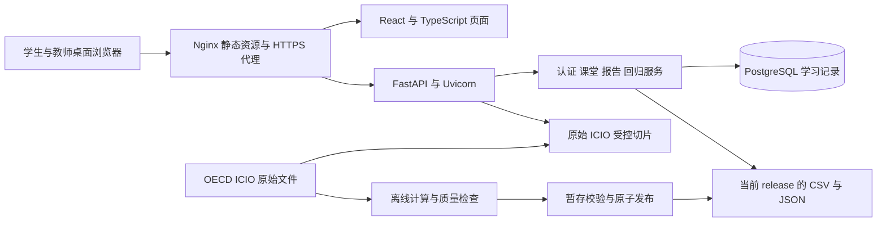
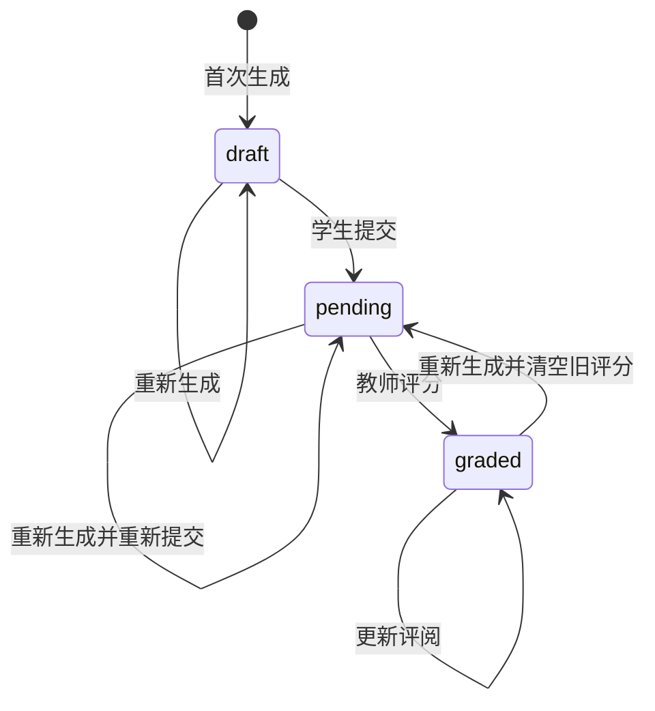

# 基于全球生产网络的国际供应链冲击虚拟仿真系统技术手册

| 项目 | 内容 |
| --- | --- |
| 系统简称 | GVC Simulation Lab／供应链仿真系统 |
| 文档版本 | 1.0 |
| 编写日期 | 2026-09-07 |
| 代码基线 | `01a367517228f5402089caa0433e4a0180f6a6e7` |
| 适用对象 | 项目建设方、教学管理人员、开发人员、部署与运维人员 |
| 编写依据 | 当前仓库的前后端代码、数据契约、部署模板和自动化测试 |

本手册描述上述代码基线已经实现的功能、计算口径和运行方式。部署地址、实际数据 `release_id`、账号与密钥属于各部署环境的配置，不在手册中固化。后续代码或数据契约更新时，应同步修订本手册。

## 目录

1. [系统概述与适用范围](#1-系统概述与适用范围)
2. [技术架构与代码组织](#2-技术架构与代码组织)
3. [教学功能与操作流程](#3-教学功能与操作流程)
4. [数据体系与发布产物](#4-数据体系与发布产物)
5. [指标计算方法](#5-指标计算方法)
6. [政策冲击构造与行业映射](#6-政策冲击构造与行业映射)
7. [回归设计与统计诊断](#7-回归设计与统计诊断)
8. [学习记录与实验报告](#8-学习记录与实验报告)
9. [数据库设计](#9-数据库设计)
10. [接口说明](#10-接口说明)
11. [身份认证与运行保护](#11-身份认证与运行保护)
12. [环境配置与本地运行](#12-环境配置与本地运行)
13. [生产部署与版本管理](#13-生产部署与版本管理)
14. [备份恢复与故障排查](#14-备份恢复与故障排查)
15. [测试验证与验收](#15-测试验证与验收)
16. [扩展维护与交付清单](#16-扩展维护与交付清单)

## 1. 系统概述与适用范围

### 1.1 建设目标

系统围绕“数据认知—指标测算—可视化比较—政策冲击分析—实证回归—实验报告”组织教学，帮助学生理解全球价值链、全球生产网络及国际供应链冲击的分析方法。学生通过浏览器完成实验操作，教师通过工作台管理学生、查看学习完成状态并评阅报告。

当前实现以 OECD ICIO 投入产出数据和教学政策编码为基础，提供指标核算、网络分析、面板回归及敏感性实验。系统中的“虚拟仿真”主要体现为数据交互、方法选择和教学情景比较；当前没有实现企业主体行为仿真、一般均衡求解或可自由编辑全部政策参数的预测引擎。

### 1.2 使用角色

| 角色 | 已实现能力 |
| --- | --- |
| 学生 | 登录与自行改密；访问 15 个步骤；浏览数据、记录观测、完成理解题、运行回归；自动保存；生成、提交和打印实验报告；查看评分与反馈 |
| 教师 | 登录与自行改密；创建学生；修改学生姓名、学号及密码；查看完成状态；查看已提交报告并评分、填写反馈 |
| 运维人员 | 通过命令行和主机工具配置环境、初始化数据库、创建首位教师、计算数据、发布版本、备份和恢复 |

运维人员不是额外的应用内角色。当前数据库不按班级或教师归属隔离学生，教师工作台管理当前部署中的学生及当前数据 release 的已提交报告。

### 1.3 客户端与部署范围

- 当前维护和验收基线是**可视区域宽度至少 1200 px 的桌面浏览器**；手机、平板和窄屏响应式适配不在当前实现范围内。
- 学生端通过浏览器使用，无须安装 Python、Bun 或 PostgreSQL。客户端操作系统与服务端操作系统相互独立。
- 仓库提供的生产运维方案基于 Linux、systemd 和 Nginx；CI 使用 Ubuntu 环境及 PostgreSQL 17。
- 自动化浏览器验收使用 agent-browser 驱动 Chrome。Firefox、Edge 等其他浏览器的兼容性，应在交付环境中按约定版本补充验收，不将 Chrome 测试结果等同于全部浏览器已通过。
- 当前面向可信课堂，未实现考试防作弊、完整安全审计、班级管理、公告、账号停用、学生自行清空或跨标签页自动合并。

依据：[README.md](README.md)、[课堂路由](gvcsim/classroom/routes.py)、[CI 配置](.github/workflows/ci.yml)。

## 2. 技术架构与代码组织

### 2.1 总体架构

系统采用 B/S 架构，分为浏览器交互层、HTTP API 层、计算与数据服务层、持久化层。大规模投入产出指标在维护窗口预计算，在线接口按需查询固定产物；学生发起回归时，服务端读取面板并执行估计。



图中的离线计算由维护人员调用，普通浏览器请求不会触发全量 ICIO 指标重算。原始表浏览接口会读取经过来源验证的必要切片，因此在线 API 仍需具有原始文件的读取权限。

### 2.2 技术栈

| 层次 | 技术 | 用途 |
| --- | --- | --- |
| 前端 | React 19、TypeScript、Vite 7 | 页面组织、交互、类型检查和静态构建 |
| 前端工具 | Bun、Bun Test | 依赖安装、构建命令和单元测试 |
| 图形与报告 | SVG／浏览器原生能力、react-markdown、remark-gfm | 交互图形、Markdown 报告展示和打印 |
| 后端 | Python 3.13、FastAPI、Pydantic、Uvicorn | API、参数验证、ASGI 服务 |
| 数值与表格 | NumPy、pandas、SciPy | 矩阵运算、数据处理和统计计算 |
| 投入产出 | pymrio | OECD ICIO 解析及投入产出基础矩阵计算 |
| 网络分析 | NetworKit、SciPy 稀疏图算法 | 精确介数与有向最短路径指标 |
| 计量校验 | linearmodels | 部分回归估计与数值对照 |
| 数据库 | PostgreSQL、psycopg、psycopg_pool | 账号、实验会话、报告、事务与连接池 |
| 部署 | Nginx、systemd、uv | HTTPS 入口、进程管理、Python 依赖管理 |
| 验证 | pytest、coverage、Ruff、Mypy、agent-browser | 后端测试、覆盖率、静态检查与浏览器验收 |

Python 依赖以 [uv.lock](uv.lock) 为锁定依据，前端依赖以 [frontend/bun.lock](frontend/bun.lock) 为锁定依据。Java 17／Maven 用于 Gephi 独立测试基准，不是业务后端的运行语言。

### 2.3 主要代码目录

| 路径 | 职责 |
| --- | --- |
| `gvcsim/api.py` | 应用生命周期、认证中间件、路由装配、健康检查及异常响应 |
| `gvcsim/data_routes.py` | 数据元信息、原始表切片、指标、网络、质检和政策冲击查询 |
| `gvcsim/regression_routes.py` | 回归参数校验、结果缓存、限流和在线计算调度 |
| `gvcsim/classroom/` | 数据库结构、连接池、学生管理、会话和报告事务 |
| `gvcsim/data/` | 原始数据验证、加载、控制变量、行业映射及质量检查 |
| `gvcsim/indicators/` | 贸易流、生产、长度和网络指标计算 |
| `gvcsim/regression/` | 回归设计、样本处理、支持度判断、估计与诊断 |
| `gvcsim/pipeline.py`、`publication.py`、`artifacts.py` | 数据计算、原子发布及产物完整性验证 |
| `gvcsim/steps.py`、`quizzes.py`、`evidence.py` | 步骤元信息、理解题和服务端完成判定 |
| `gvcsim/teaching_report.py` | 报告材料校验、计算结果解释、报告与来源信息生成 |
| `frontend/src/labs/`、`viz/` | 各教学步骤及可视化组件 |
| `frontend/src/use-session.ts`、`session-store.ts` | 自动保存、冲突处理及恢复逻辑 |
| `frontend/src/teacher/` | 教师学生管理和报告评阅页面 |
| `scripts/`、`tests/`、`deploy/` | 运维与验收脚本、自动化测试、部署模板 |

依据：[Python 项目配置](pyproject.toml)、[前端项目配置](frontend/package.json)、[API 应用](gvcsim/api.py)。

## 3. 教学功能与操作流程

### 3.1 五个阶段与 15 个步骤

| 阶段 | 步骤 | 模块 | 主要操作与输出 |
| --- | --- | --- | --- |
| 数据接入 | 1 | OECD ICIO 数据浏览 | 按年份、表类型、国家和行业查看切片；记录一个具体单元格 |
| 指标计算 | 2 | GVC 总贸易流分解 | 阅读 WWZ 五类聚合项及 TLS 扩展；记录比较对象 |
| 指标计算 | 3 | GVC 生产分解 | 比较纯国内、传统贸易、简单与复杂 GVC 增加值 |
| 指标计算 | 4 | GVC 长度分解 | 阅读前向、后向生产长度和相对位置指标 |
| 指标计算 | 5 | 全球生产网络指标 | 比较度、加权度、最短路径指标与介数 |
| 可视化分析 | 6 | 贸易流指标可视化 | 新会话先看出口拆解，再选定位图或占比排名；已有视角继续恢复 |
| 可视化分析 | 7 | 生产指标可视化 | 四类生产构成、复杂 GVC 排名及行业下钻 |
| 可视化分析 | 8 | 长度指标可视化 | 前后向链长、上下游位置和排名比较 |
| 可视化分析 | 9 | 网络指标可视化 | 国家贸易图、行业热力表、中心性比较与大图查看 |
| 回归设计与建模 | 10 | 认识模拟关税数据 | 查看固定冲击前出口份额、模拟税率及唯一教学 X |
| 回归设计与建模 | 11 | 出口价值构成发生了什么变化？ | 分析外国增加值项占比（字段仍为 FVA_share） |
| 回归设计与建模 | 12 | 生产指标回归 | 分析复杂 GVC 生产份额 |
| 回归设计与建模 | 13 | 长度指标回归 | 分析前向 GVC 生产长度 |
| 回归设计与建模 | 14 | 网络指标回归 | 探索全正边二值网络介数 |
| 实验闭环 | 15 | 实验报告 | 填写原创分析；生成、复核、提交和打印报告 |

学生可以自由访问各步骤；报告生成统一检查前置理解题和实验材料。步骤元信息中的 `done`／`demo` 表示所用数据的真实性类别，不表示功能是否开发完成。

### 3.2 理解题与完成状态

步骤 1–14 共包含 19 道固定理解题。题库版本为 `course-quiz-v8`，题目由服务端下发，提交后由服务端判定。服务端在读取学习记录时会重新核验答案和题库版本，不直接信任浏览器保存的“已完成”标记。

步骤 1–14 的理解完成状态与报告材料齐备状态分别计算。理解题通过后，若没有记录所需观测或回归结果，报告仍可能不能生成。步骤 15 的完成条件为已成功生成报告；“已完成 15 步”不等同于报告已提交或已评分。

### 3.3 推荐教学操作顺序

1. 学生登录，确认数据年份、当前课程和来源说明。
2. 在步骤 1 选择并保存原始表单元格，明确供给方行、使用方列及单位。
3. 在步骤 2–9 分别完成指标阅读与比较，显式保存观测。
4. 在步骤 10 查看版本 `step10-tariff-teaching-v1` 的透明 mock X，并保存教学国家、年份与已查看标记。
5. 在步骤 11–14 保存四个独立模拟 Y 的固定 TWFE 强度结果；只描述关联，不作因果解释。
6. 填写研究问题、证据解释、局限与反思，生成报告并复核，再提交教师。
7. 教师阅读报告，给予 0–100 分及文字反馈；学生查看评阅结果。

依据：[步骤定义](gvcsim/steps.py)、[题库](gvcsim/quizzes.py)、[完成判定](gvcsim/evidence.py)。

## 4. 数据体系与发布产物

### 4.1 原始投入产出数据

正式指标基于 OECD ICIO 2023 版，当前课程使用 2016–2020 年数据。原始维度契约包含 77 个区域账户、45 个行业和 6 类最终需求；77 个区域账户包括 76 个具名经济体及 `ROW` 剩余地区账户。

| 对象 | 结构及含义 |
| --- | --- |
| `Z` | 3465 × 3465 中间使用矩阵，行为供给方国家—行业，列为使用方国家—行业 |
| `Y` | 国家—行业对目的国最终需求类别的供应；六类为 `HFCE`、`NPISH`、`GGFC`、`GFCF`、`INVNT`、`DPABR` |
| `TLS` | 产品税减补贴账户 |
| `VA` | 增加值账户；代码与 TLS 分别保存、计算 |
| `OUT` | 原始总产出账户，独立读取以支持核算核验 |
| 单位 | 原始金额按 ICIO 口径使用百万美元；份额、生产长度和中心性另有单位 |

同一年只能存在一个有效原始来源。系统检查文件结构、完整维度、重复标签、数值和年份一致性，不通过自动填零或静默丢列修复原始表。

### 4.2 数据真实性分类

| 数据 | 当前来源与性质 |
| --- | --- |
| 投入产出表 | OECD ICIO 原始输入 |
| 四类指标及双边出口暴露度 | 按项目实现从 ICIO 推导，可追溯至原始输入 |
| v15 教学关税 X 与四个 Y | 来源绑定、固定 seed 的教学模拟，不能视为历史政策或 OECD 观测 |
| HS6→ISIC→ICIO 示例 | 六个选定商品的分类示例，配套税率和贸易权重为虚构教学篮子 |
| 宏观变量与平减指数 | 确定性教学 mock，不是 WDI／IMF 观测数据 |
| CI 合成 ICIO 表 | 专用于自动化测试的 15 区域 × 24 行业 × 5 年小型矩阵 |

真实投入产出来源不意味着全部政策变量、图中分组或回归结论都是 OECD 官方结果。报告应保留对应来源说明和方法边界。

### 4.3 文件组织

```text
原始数据目录/
  ICIO2023_2016.csv
  ...
  ICIO2023_2020.csv

数据目录/
  processed -> .processed-releases/<release_id>
  .processed-releases/
    <release_id>/
      dataset.json
      indicators_country_<year>.csv
      indicators_industry_<year>.csv
      network_edges_<year>.csv
      export_exposure_<year>.csv
      tariff_exposure_lookup.csv
      panel_country.csv
      panel_industry.csv
      controls_country.csv
      demo_trade_war_tariffs.csv
      qc_<year>.json
      qc_outputs_<year>.json
      qc_controls.json
      qc_shocks.json
      qc_regression_inputs.json
```

`processed` 是当前发布的固定入口。实际路径由 `GVCSIM_DATA_DIR` 与 `GVCSIM_RAW_DATA_DIR` 配置。原始表和分析产物保存在文件系统，PostgreSQL 保存账号与教学记录。

### 4.4 数据契约与质量门槛

| 契约 | 当前值 |
| --- | --- |
| 数据产物契约 | `ARTIFACT_CONTRACT_VERSION = 14` |
| 政策冲击契约 | `SHOCK_CONTRACT_VERSION = 3` |
| 课程发布 | `2026-fall-15-step-economics-v2` |
| 教学数据库 | `gvcsim-teaching-db-v11` |
| 实验会话 | `experiment-session-simple-v3` |
| 理解题题库 | `course-quiz-v8` |

`dataset.json` 保存 release 标识、年份、课程发布、来源、QC 摘要、网络算法和产物清单。产物清单包括文件 SHA-256、大小和结构信息；原始来源也按文件名、字节数和内容哈希绑定。

发布检查区分两类问题：

- **完整性问题**：缺文件、哈希不符、结构错误、键覆盖不完整或来源不匹配等，阻止发布或服务使用。
- **数值、经济含义和回归设计诊断**：保存在 QC 和报告中持续披露，不以“数据发布成功”代替经济解释或统计推断的判断。

指标本身未定义时允许按相应字段契约保留缺失，例如零活动的链长；这与原始数据非法缺失、任意非有限输入是不同情况。

依据：[原始维度契约](gvcsim/data/icio2023_dimensions_v1.json)、[原始验证](gvcsim/data/raw_icio.py)、[流水线](gvcsim/pipeline.py)、[产物契约](gvcsim/artifacts.py)。

## 5. 指标计算方法

### 5.1 共同矩阵与符号

以下符号与 `IcioArrays` 的实现对应。`⊙` 为逐元素相乘，向量之间的除法表示逐元素相除。

| 符号 | 定义 |
| --- | --- |
| `x` | 总产出向量 |
| `A` | 技术系数矩阵，`A_ij = Z_ij / x_j` |
| `B` | 全球里昂惕夫逆，`B = (I − A)⁻¹` |
| `L` | 各国内部逆矩阵 `(I − A_rr)⁻¹` 组成的块对角矩阵 |
| `A^F` | 从 `A` 中去除国内块后得到的跨境技术系数 |
| `v`、`t` | 纯增加值系数 `VA/x`、产品税减补贴系数 `TLS/x` |
| `yᴰ`、`yᶠ` | 本国最终需求和出口最终需求对应的向量 |
| `E` | 中间品出口与最终品出口之和，剔除国内销售 |

核算关系包括 `x = Z·1 + Y·1`、`x = B·y`；完整 VA 与 TLS 账户下，`(v+t)ᵀB = 1ᵀ`。质检还使用独立读取的原始 `OUT`，避免仅将同一派生值与自身比较。

### 5.2 总贸易流分解

系统将 WWZ 16 个双边明细项对进口伙伴加总，输出五类聚合项，并额外计算 OECD TLS 账户含量；不落盘完整的双边 16 项明细。

| 字段 | 含义 |
| --- | --- |
| `DVAex` | 出口后被外国最终吸收的国内增加值 |
| `DVArt` | 出口后最终返回国内的增加值 |
| `DDC` | 国内纯重复计算部分 |
| `FVA` | WWZ 外国增加值部分，不包含 `FDC` |
| `FDC` | 外国纯重复计算部分 |
| `taxsub` | 出口中产品税减补贴含量，是项目的 OECD 账户扩展 |
| `EXDVA` | 派生量 `DVAex + DVArt` |

```text
gross_exports = DVAex + DVArt + DDC + FVA + FDC + taxsub
EXDVA = DVAex + DVArt
FVA_share = FVA / gross_exports    （gross_exports > 0）
```

`EXDVA` 不再次计入总出口闭合式。课程 FVA 份额的分子不含 `FDC` 和 `TLS`，因此不能标为 OECD 官方 `EXGR_FVASH`；按本实现，总出口中来自外国的纯 VA 总含量为 `FVA + FDC`。

国家级金额先按行业加总，再计算份额，不直接平均行业份额。负值应结合原始有符号账户、数值误差和具体分解项判断，不能一律截断为零或一律解释为补贴。

### 5.3 生产活动分解

前向分解以增加值来源行业记账：

```text
SVA          = v ⊙ x
1_VA_D       = v ⊙ (L yᴰ)
2_VA_RT      = v ⊙ (L yᶠ)
3_VA_GVC     = v ⊙ (L A^F x)
3a_VA_GVC_S  = v ⊙ (L A^F L yᴰ)
3b_VA_GVC_C  = 3_VA_GVC − 3a_VA_GVC_S
```

其中纯国内、传统贸易、简单 GVC、复杂 GVC 四部分加总为 `SVA`。简单 GVC 对应中间品跨境一次后实现最终吸收；复杂 GVC 至少包含一次中间品跨境且总跨境次数至少为两次，后续跨境可以是最终品贸易。

后向分解以最终产品完成地记账，输出 `FGY` 及对应的 `1_FGY_D`、`2_FGY_RT`、`3_FGY_GVC`、`3a_FGY_GVC_S`、`3b_FGY_GVC_C`。

```text
复杂 GVC 生产份额 = 3b_VA_GVC_C / SVA    （SVA > 0）
GVC 生产份额      = 3_VA_GVC / SVA      （SVA > 0）
```

份额衡量构成，不能直接用作生产规模、供应链韧性或经济重要性的统一度量。

### 5.4 生产长度与位置

生产长度是某类活动诱发的累计总产出与关联增加值的比值。前向视角从增加值创造端追踪最终吸收，后向视角从最终产品端回溯增加值来源。

```text
PLv = (B x) / x
PLy = (vᵀ B B) / (vᵀ B)

PLv_GVC = (L L A^F x + L A^F B x) / (L A^F x)
PLy_GVC = (vᵀ L L A^F B + vᵀ L A^F B B) / (vᵀ L A^F B)

Pos_TPL = PLv / PLy
GVCPs   = PLv_GVC / PLy_GVC
```

上式展示约去公共项后的比值；实际代码保留增加值等分子、分母分量，以便进行行业及国家聚合。对应活动不存在或分母绝对值不超过 `1e-12` 时，结果记为缺失，不伪造零长度。

国家级长度按分子和分母分别加总后取比值。增加值为正时可以解释为增加值加权平均；存在负增加值时为有符号账户加权。总长度由各类活动长度按对应增加值构成加权，而不是把几类长度直接相加。

`GVCPs > 1` 表示在此口径下相对更上游，不能单凭该值将一个经济体归类为资源国。

### 5.5 生产网络指标

国家图的边为国家间中间品与最终品贸易流，不包含国内边。国家—行业图以完整 `Z` 为邻接矩阵，节点为国家—行业，保留所有有限正流量边及正自环。

| 指标 | 实现口径 |
| --- | --- |
| 入度、出度、总度 | 正流量边的有向计数，总度为入度加出度 |
| 加权入度、出度、总度 | 对应流量之和；正自环在入向、出向各计一次 |
| `Eccentricity` | 沿出边可达节点的最大最短路径距离；无可达对象时为 0 |
| `closnesscentrality` | 可达节点数除以可达距离之和 |
| `harmonicclosnesscentrality` | 可达节点距离倒数之和除以可达节点数 |
| `betweenesscentrality` | 有向、无权、精确 Brandes 介数，未归一化 |
| `eigencentrality` | 复现 Gephi 0.10.1 的 100 次累计入边迭代兼容分数 |

接口保留 `closnesscentrality`、`betweenesscentrality` 等历史拼写，维护时不能只改字段名而不同步契约。`eigencentrality` 不应解释为标准 Perron 特征向量中心性。

路径类指标不以流量大小决定距离，微小正边和大额边均视为一条边。国家贸易图在当前真实数据口径下为完全图，国家介数恒为 0，故网络回归仅开放国家—行业级。

前端国家贸易图展示选出的主要边；中心性在完整计算图上求得，不能将展示边集误认为计算边集。行业下钻只改变展示范围。当前未实现边阈值敏感性分析，介数应作为探索性拓扑指标解释。

依据：[基础矩阵](gvcsim/indicators/core.py)、[贸易分解](gvcsim/indicators/tradeflow.py)、[生产分解](gvcsim/indicators/production.py)、[长度计算](gvcsim/indicators/length.py)、[网络算法](gvcsim/indicators/network.py)、[指标释义](gvcsim/indicator_schema.py)。

## 6. 政策冲击构造与行业映射

### 6.1 当前课程冲击

当前步骤 10–14 只公开 `tariff` 教学模拟，不再把旧事件目录、制裁或出口管制流程作为学生必做界面。唯一 X 为 `teaching_tariff_exposure`；它与四个独立 Y 一起发布在 `panel_teaching.csv`。

### 6.2 教学关税暴露

```text
X[c,s,t] = w[c,s,USA,首年] × τ[t]
τ[t]     = (0, 0, 0.65, 1.00, 0.55)
```

- `w` 来自当前 release 首年国家—行业销往美国的非负出口份额；缺失、非有限或超出定义域的源记录不进入教学面板。
- `τ` 是无量纲虚构路径，不是美国真实关税。X 也是教学模拟，按比例存储、按百分点展示。
- 生成器 seed 固定为 `20260913`。四个 Y 分别使用源指标首年排名校准、预设关系和独立哈希扰动；不保留源指标真实水平或核算恒等式。
- `dataset.json.simulation_contract` 绑定版本、seed、参数、`panel_industry.csv` 与逐年 `export_exposure` 哈希。相同 seed 但来源不同，不是同一发布。

### 6.3 遗留映射材料

旧 HS6 分类示例可用于讲解加权，但不出现在当前学生必做步骤，也不进入 `panel_teaching.csv`：

当前示例包含 `010121`、`030111`、`854231`、`854239`、`870323`、`940360` 六个商品，按商品的生产活动映射至 ISIC，再映射至 ICIO 行业。分类不按商品所含的上游投入拆分。

行业平均税率保留未列入加税清单的商品作为分母。例如虚构 2019 年 C26 篮子中：

```text
受税商品权重 0.20，税率 0.25
未受税商品权重 0.30，税率 0
行业平均税率 = (0.20 × 0.25 + 0.30 × 0) / (0.20 + 0.30) = 0.10
```

该示例用于讲解分类和加权，不是美国 301 官方清单，也不作为政策回归面板的输入。

依据：[教学面板生成器](gvcsim/regression/teaching.py)、[暴露度构造](gvcsim/shocks.py)。

## 7. 回归设计与统计诊断

### 7.1 四类预设结果

| `outcome` | 因变量 | 解释单位 |
| --- | --- | --- |
| `trade` | `teaching_y_trade` | 模拟份额尺度；按百分点解释 |
| `production` | `teaching_y_production` | 模拟份额尺度；按百分点解释 |
| `length` | `teaching_y_length` | 模拟长度尺度 |
| `network` | `teaching_y_network` | 模拟网络尺度，探索性解释 |

教学面板固定为国家—行业级，个体键 `entity_id`，标准误按 `country` 聚类；模拟 Y 只借用对应真实指标的尺度生成可读水平，不是 OECD 指标。

### 7.2 当前课程固定模型

| `method` | 当前课程含义 |
| --- | --- |
| `twfe_intensity` | 连续冲击强度的个体与年份双向固定效应，作为描述性关联 |

步骤 11–14 只接受 `step10-tariff-teaching-v1` 快照中的模拟 X、对应步骤的独立模拟 Y，以及固定的国家×行业和年份效应：

```text
Y_it = β X_it + α_i + λ_t + ε_it
```

X 为固定冲击前出口份额乘模拟税率，不是处理批次指示变量；因此当前课程不采用 cohort/DID 或动态 ATT 解释。系数与区间只描述模拟变量之间的关联，不证明现实政策因果效应。

### 7.3 公开参数及约束

| 参数 | 默认值 | 可用范围或限制 |
| --- | --- | --- |
| `outcome` | 必填 | 四类稳定英文键 |
| `granularity` | `country_industry` | `country_industry`／`country`；网络仅前者 |
| `shock_type` | `tariff` | 当前课程固定为模拟关税 |
| `method` | `twfe_intensity` | 当前课程固定为连续强度 TWFE |
| `control_mode` | `none` | 固定为 `none` |
| `interaction` | `false` | 固定为 `false` |
| `price_mode` | `nominal` | 当前公开参数组合只允许 `nominal` |
| `scenario` | `clean` | 当前课程固定为 `clean` |
| `exclude_row` | `true` | 默认排除 ROW；修改该项需在解释中披露 |
| `weight_mode` | `fixed_pretreatment` | `contemporaneous` 仅允许关税 |

代码中仍保留 ICIO 派生控制量、宏观 mock 和 `real_2016` 等教学数据构造能力，但公开回归拒绝加入这些控制变量；没有金额控制变量时也拒绝 `real_2016`。接口调用方应同时读取 options 中的约束并遵守服务端校验，不能将全部枚举标签当成全部可执行组合。

### 7.4 支持度与停止推断

| 状态 | 含义与处理 |
| --- | --- |
| `ok` | 当前实现的检查未发现停止条件；仍需结合研究假设解释 |
| `warning` | 存在需要说明的限制，应进一步查看逐项诊断 |
| `insufficient` | 实际处理或对照支持不足，抑制统计推断 |
| `invalid_design` | 处理路径、方差或其他设计条件不适合当前估计，抑制统计推断 |

当前固定 TWFE 检查 X 的变异、吸收后的设计矩阵、有效样本和聚类协方差。条件不满足时不发布 p 值、显著性或置信区间；结果使用空系数列表或明确诊断。完整诊断可以作为报告材料，课程不要求学生反复试设定直到得到显著结果。

### 7.5 结果解释

四类结果应并排阅读，区分指标单位、方向、不确定性和支持度。区间跨零不能写成“没有关联”；即使区间不跨零，也不能把预设模拟关系写成现实政策因果效应。`clean` 是当前唯一公开教学情景。

依据：[设计定义](gvcsim/regression/design.py)、[HTTP 契约](gvcsim/regression/contracts.py)、[路由约束](gvcsim/regression_routes.py)、[估计实现](gvcsim/regression/panel.py)、[支持度判定](gvcsim/regression/validity.py)。

## 8. 学习记录与实验报告

### 8.1 会话结构与自动保存

会话采用 JSON 对象，基本结构如下；省略的步骤在实际使用中按操作产生：

```json
{
  "version": "experiment-session-simple-v3",
  "steps": {
    "1": {"data": {}},
    "11": {"data": {}},
    "15": {"data": {}}
  },
  "shared": {}
}
```

步骤键仅允许 `1`–`15`，每步记录必须具有 `data` 对象；共享业务键当前为 `regression_settings`。会话规范化后的 UTF-8 JSON 上限为 1,000,000 字节，拒绝非有限数值、U+0000、非法 Unicode 和不能序列化的值。

前端编辑后等待 800 ms 自动保存，同一标签页同时最多发送一个保存请求；在途编辑合并为下一份最新快照。理解题完成、生成／提交报告及退出前会主动尝试完成保存。突然关闭浏览器仍可能丢失最后尚未保存的编辑。

每次 PUT 必须携带 `base_updated_at`。首次未保存时显式传 `null`；后续使用服务器最后确认的版本。其他标签页已保存时返回 409，当前页面要求用户显式载入服务器版本，不静默覆盖。

网络失败会保留本页最新快照并提供重试。认证失效或自行改密退出时的未保存内容可在当前标签页暂存；恢复仅面向同一账号和同一 release，并需要显式操作。该机制不等同于完整离线同步。

### 8.2 报告生成条件

| 范围 | 服务端校验 |
| --- | --- |
| 步骤 1–14 | 当前题库的理解题全部答对 |
| 步骤 1 | 已记录具体单元格的行、列和值 |
| 步骤 2–9 | 每步至少两个比较对象或两条指标观测 |
| 步骤 10 | 保存 `teaching_country`、`teaching_year`、`viewed_teaching_panel: true`、`teaching_panel_version: step10-tariff-teaching-v1` |
| 步骤 11–14 | 每步保存服务端返回的同版本 `model_snapshot`、实际 X/Y `variable_catalog` 与固定模型结果；旧 DID 快照无效 |
| 步骤 15 | 研究问题至少 12 字符、证据解释至少 40 字符、局限与反思至少 30 字符；每项最多 2400 字符 |

第 6 步保留比较对象，并在数值可用时附上外国增加值项占比这一代表指标；不保存定位图双轴或出口拆解的全部分项。材料门槛不验证是否访问过所有图表，报告在仅有比较对象时明确说明未记录代表指标数值。该简化不新增会话字段，也不改变既有完成规则。

界面优先使用中文观察问题和短指标名；FVA/FDC/TLS 及统计口径差异集中保留在指标列说明、回归折叠说明和报告技术附录。数据来源仍必须明确：课程数据标签和介绍根据当前 release 区分 OECD 数据、CI 合成数据与来源待确认状态。

文字最小长度按规范化空白后的内容检查，长度达标只表示材料门槛满足，不自动保证论证质量。形成性方向判断练习不替代固定理解题，也不要求学生猜中系数方向才能生成报告。

回归记录中的 `run` 保存最新结果，`qualified_run` 可保留历史可推断参考结果。新版完整诊断优先进入报告，不能被旧的可推断快照掩盖；诊断不应被写成“可推断参考结果”。

### 8.3 报告内容与状态

报告从已保存会话生成 Markdown，并保存 `provenance` 来源与版本信息。内容包括实际记录的观测、理解题、四类回归设置与证据、研究问题、解释和局限，以及数据来源、QC 和推断边界。



- `draft`：草稿，尚未提交。
- `pending`：已提交，等待评阅。
- `graded`：已评分并保存反馈。

每个学生、每个 release 只有一份当前报告，没有多份独立历史稿库。已提交或已评分报告重新生成后会进入待评阅状态，旧评分和评语被清除。

报告生成先读取会话快照，在计算结束写入时再次比较版本；期间若会话已变，返回 409。教师评分必须携带报告的 `expected_updated_at`，防止对已经更新的报告写入旧评阅。

“导出 PDF”使用浏览器打印能力及打印样式，用户在打印对话框保存为 PDF；后端没有独立 PDF 二进制生成接口。

依据：[会话模型](gvcsim/session.py)、[前端同步](frontend/src/use-session.ts)、[报告生成](gvcsim/teaching_report.py)、[报告事务](gvcsim/classroom/records.py)、[报告页面](frontend/src/labs/steps/report-lab.tsx)。

## 9. 数据库设计

### 9.1 逻辑模型

| 表 | 主键 | 关键字段 | 用途 |
| --- | --- | --- | --- |
| `schema_meta` | `singleton` | `version`、`created_at` | 当前教学库版本，单行约束 |
| `accounts` | 自增 `id` | `username`、`display_name`、`role`、`student_no`、`pw_salt`、`pw_hash`、`auth_version`、时间字段 | 账号与认证信息 |
| `experiment_sessions` | `(account_id, release_id)` | `session jsonb`、`updated_at` | 当前 release 下的学习会话 |
| `reports` | `(account_id, release_id)` | `markdown`、`provenance jsonb`、`state`、`score`、`feedback`、`graded_by`、时间字段 | 报告内容与评阅 |

`username` 唯一；角色限定为 `student` 或 `teacher`；`release_id` 为 32 位小写十六进制字符串。会话和报告通过外键关联账号，数据库定义账号删除时级联删除，但当前应用没有开放账号删除接口。

报告状态限定为 `draft`、`pending`、`graded`，分数限定为 0–100。数据库采用 `timestamptz` 保存时间。

### 9.2 事务与隔离

- 会话保存使用数据库事务、行级协调与版本比较，处理首次插入竞争和旧标签页覆盖。
- 报告生成写入与评分均校验所依据的快照版本。
- 密码更新会递增 `auth_version`，旧令牌在后续验证时失效。
- 数据库操作异常进行回滚，避免将处于失败事务中的连接交回池后继续使用。
- schema 初始化使用 PostgreSQL advisory lock 协调；运行中的 API 只检查 schema，不自动建表或迁移。

### 9.3 版本管理原则

`classroom-init` 可初始化空数据库或检查兼容数据库。当前代码不提供旧教学库的自动保留数据迁移；遇到版本不匹配应停止并确定迁移或课程清场方案。

`classroom-init --reset` 实际执行 `DROP SCHEMA public CASCADE` 后重建，会删除目标数据库 `public` 中的全部对象，包括账号、会话和报告。它只适用于明确选定的独立教学库，并且不应出现在普通代码更新流程中。

依据：[数据库 schema](gvcsim/classroom/schema.py)、[连接与账号](gvcsim/classroom/db.py)、[记录事务](gvcsim/classroom/records.py)、[CLI](gvcsim/cli.py)。

## 10. 接口说明

### 10.1 通用约定

API 请求与响应使用 JSON。除登录和单独验证令牌的路由外，所有 `/api/` 接口均由中间件要求 `Authorization: Bearer <token>`；`/api/auth/me` 自行验证令牌。健康检查不要求登录。

前端一般 GET 超时为 10 秒，写入与计算请求超时为 120 秒。HTTP 成功只表示请求已被处理，回归是否可推断还要读取 `result.status`、`support` 和逐项诊断。

### 10.2 认证与健康接口

| 方法 | 路径 | 权限 | 内容 |
| --- | --- | --- | --- |
| POST | `/api/auth/login` | 公开，限流 | 用户名、密码登录，返回令牌、到期时间和用户信息 |
| GET | `/api/auth/me` | 自行校验 Bearer | 返回当前账号信息 |
| POST | `/api/auth/password` | 已登录 | 验证当前密码并修改本人密码，要求重新登录 |
| GET | `/health/live` | 公开 | 检查事件循环存活，不读取数据库或数据文件 |
| GET | `/health` | 公开 | 检查数据产物、原始来源绑定和数据库就绪 |

### 10.3 数据与分析接口

以下 GET 接口供已登录用户访问。

| 路径 | 主要参数／用途 |
| --- | --- |
| `/api/meta` | 年份、国家和当前数据元信息 |
| `/api/steps` | 15 步元信息及理解题 |
| `/api/indicators/schema` | 指标字段、定义和单位 |
| `/api/db/meta` | 原始 ICIO 表维度与账户结构 |
| `/api/db/slice` | `year`、`table=z/y/accounts`、国家／行业筛选、分页 |
| `/api/indicators/country/{year}` | 国家级指标，可按 `country` 筛选 |
| `/api/indicators/industry/{year}` | 行业级指标，可按国家与行业筛选 |
| `/api/viz/network/{year}` | 网络展示节点和边 |
| `/api/qc/{year}` | 指定年份的输入质量检查 |
| `/api/qc/controls`、`/api/qc/shocks` | 控制变量与冲击面板质量检查 |
| `/api/shocks/events` | 当前 release 可选的政策事件与来源说明 |
| `/api/shocks/summary` | 按冲击类型汇总逐年处理及非零覆盖 |
| `/api/shocks/panel` | 冲击行筛选、排序、分页及暴露度说明 |
| `/api/crosswalk/demo` | 2018、2019 或 2020 年的六商品教学映射 |
| `/api/regression/options` | 回归稳定键、标签及参数约束 |
| `/api/regression/design` | 设计、方程、面板及聚类说明，不执行估计 |

原始切片与冲击面板的 `page` 从 1 开始，`page_size` 默认 25、最大 200。冲击面板过滤为 `all`、`treated`、`nonzero`；排序为 `intensity_desc`、`intensity_asc`、`country_asc`、`sector_asc`。旧 `only_hit` 查询参数已标为弃用，新集成应使用 `filter`。

| 方法 | 路径 | 权限 | 用途 |
| --- | --- | --- | --- |
| POST | `/api/regression/run` | 学生 | 执行所选回归，返回设计、结果、预检、数值复核和声明 |
| POST | `/api/regression/placebo` | 学生 | 遗留扩展接口；不属于当前固定 v15 学生旅程 |

### 10.4 学生与教师接口

路径均以 `/api/classroom` 为前缀。

| 方法 | 路径 | 角色 | 用途 |
| --- | --- | --- | --- |
| GET | `/session` | 学生 | 获取会话、报告、版本及完成／材料状态 |
| PUT | `/session` | 学生 | 保存会话，必须携带 `base_updated_at` |
| POST | `/quiz/submit` | 学生 | 提交 `step`、题库 `version`、`answers` 并判题 |
| POST | `/report/generate` | 学生 | 从服务器已保存记录生成报告 |
| POST | `/report/submit` | 学生 | 提交已经生成的报告 |
| GET | `/students` | 教师 | 学生列表与当前完成状态 |
| POST | `/students` | 教师 | 创建学生 |
| POST | `/students/{account_id}` | 教师 | 修改姓名、学号或密码 |
| GET | `/reports` | 教师 | 当前 release 的待评阅／已评阅报告 |
| GET | `/reports/{account_id}` | 教师 | 查看已提交报告详情 |
| POST | `/reports/{account_id}/grade` | 教师 | 提交分数、评语和 `expected_updated_at` |

创建学生的用户名为 2–40 字符，只允许字母、数字、下划线、点和连字符；姓名 1–60 字符且不能全为空白；新密码 12–256 字符。修改学生时省略字段表示不修改，清空学号使用空字符串，不使用 `null`。评分反馈最多 4000 字符。

### 10.5 请求示例

以下是请求体示例，地址和令牌应由调用环境提供。

```http
POST /api/regression/run
Authorization: Bearer <访问令牌>
Content-Type: application/json
```

```json
{
  "outcome": "trade",
  "granularity": "country_industry",
  "shock_type": "tariff",
  "method": "twfe_intensity",
  "control_mode": "none",
  "interaction": false,
  "price_mode": "nominal",
  "scenario": "clean",
  "exclude_row": true,
  "weight_mode": "fixed_pretreatment"
}
```

响应顶层为 `design`、`result`、`preflight`、`benchmark`、`disclaimer`。`result` 包括系数、样本规模、支持度、样本筛选过程和诊断等；完整结构以代码中的响应模型和实际方法返回为准。

首次保存空会话的请求体结构为：

```json
{
  "session": {
    "version": "experiment-session-simple-v3",
    "steps": {},
    "shared": {}
  },
  "base_updated_at": null
}
```

### 10.6 常见响应状态

| 状态码 | 常见含义 |
| --- | --- |
| 400 | 无效业务参数、被禁止的回归组合、当前密码错误或计算设计无法成立 |
| 401 | 无令牌、令牌过期、数据 release 或认证版本已改变 |
| 403 | 当前角色无权执行操作 |
| 404 | 对象、数据年份或可见报告不存在 |
| 409 | 会话／报告版本冲突、报告材料不齐、重复账号、数据契约异常等；应按具体 `detail` 处理 |
| 422 | 请求结构、类型、长度或字段验证失败 |
| 429 | 请求超过频率限制，响应包含 `Retry-After` |
| 503 | 数据库或数据发布未就绪，或服务容量限制触发 |

FastAPI 提供的 OpenAPI 结构可在受控开发环境核对；生产 Nginx 模板限制外部访问 `/docs`，不应依赖开发文档页面作为用户操作入口。

依据：[数据路由](gvcsim/data_routes.py)、[认证路由](gvcsim/auth_routes.py)、[课堂路由](gvcsim/classroom/routes.py)、[前端请求封装](frontend/src/api.ts)。

## 11. 身份认证与运行保护

### 11.1 认证设计

- 密码采用独立随机盐与 PBKDF2-HMAC-SHA256 派生，当前迭代次数为 100,000；密码不以明文存入数据库。
- 访问令牌采用 HMAC-SHA256 签名，包含账号标识、角色、账号认证版本、数据 release 和到期时间。它是项目自定义的两段式签名令牌，不是三段式 JWT。
- 令牌默认有效期 2,592,000 秒，即 30 天，可通过 `GVCSIM_TOKEN_TTL_SECONDS` 覆盖；既有环境中的显式 28,800 秒不会被代码默认值覆盖，已签发令牌也不会自动延长。验证时仍检查当前账号和 release，数据换版、改密或教师重置密码会使旧令牌失效。
- 前端仅在当前标签的 sessionStorage 保存令牌，刷新保留，不监听其他标签的登录/退出。不新增续期接口或服务端登录会话表。首次升级不沿用旧 localStorage 登录，需重新登录；实验记录仍按原账号从服务器恢复。顶部不再显示会话到期时间。
- 每个页面仍固定使用自身已验证的令牌，迟到请求不得跨账号保存；退出仅清除本标签登录，不撤销其他标签的有效令牌。
- 认证依赖临时不可用时返回 503，前端保留登录上下文并允许重试；明确失效则要求重新登录。

### 11.2 运行容量

| 机制 | 当前默认或模板配置 |
| --- | --- |
| Uvicorn worker | CLI 固定为 1 |
| AnyIO 同步线程令牌 | 16，供认证、保存和普通同步工作使用 |
| 回归准备／报告同步工作 | 共享普通线程；额外最多接纳 64 项（含运行中），满额返回可重试 503；不套用 CPU 的计算期限 |
| 原始 ICIO 读取 | 独立 2 个线程；同年完整表合并读取，最多缓存 5 年 |
| 高成本任务并发 | 回归、置换和报告共享 4 个计算名额 |
| 排队与期限 | CPU、原始读取各最多接纳 64 个任务（含运行中）；排队最长 15 秒，计算期限 90 秒，调度阶段最迟 105 秒响应；超限返回 503 和 `Retry-After: 5` |
| PostgreSQL 连接池 | 最小 1、最大 8，取连接等待 5 秒 |
| 回归／置换结果缓存 | 最多 64 个完成结果，按 release、操作与请求参数区分 |
| 同参数并发计算 | single-flight 合并；最多 64 个未完成键，每账号最多发起 1 个未完成计算；加入相同计算和读取缓存不占账号限额 |
| Uvicorn 同时连接／任务限制 | 默认 512，超过时可返回 503 |
| Nginx upstream 空闲连接 | 每个 Nginx worker 最多 8 个，2 秒回收 |
| 登录频率 | 每来源—用户名 10 次／分钟，每来源总计 120 次／分钟 |
| 高成本计算频率 | 每账号主回归 12 次／分钟，置换 4 次／分钟；实际缓存未命中才计入计算限流 |

限流与缓存是进程内机制。多 worker、多实例或分布式部署需要重新设计共享限流、容量、缓存与一致性验证，不能仅增加进程数就认为具备等效保护。

账号频率检查在发布共享任务之前执行，某位学生的 429 不会传播给其他等待者。最后一个等待者断开连接后，排队任务立即取消；运行中的数值计算在协作检查点退出，线程实际结束后才释放名额。保存和提交继续使用原有数据库事务与版本冲突规则。

回归面板读取、报告会话读取、落库与学习状态整理统一通过受跟踪的同步任务执行。取消通过 AnyIO cancel scope 撤销尚未分配线程的工作，已分配的工作屏蔽取消并持有普通线程令牌和准入名额直到真正结束；退出的请求不再继续后续计算。报告仅在读取／构建阶段监听断连，进入落库阶段后按原有事务规则完成处理，响应丢失不等于事务回滚。停机先收尾同步任务，再关闭 PostgreSQL 连接池。具体复现和测试见[普通 I/O 取消边界](docs/classroom-io-cancellation-fixes-20260908.md)。

前端 GET 遇到 502／503／504 时在总计 10 秒的预算内最多请求 3 次，遵循 `Retry-After` 并加入退避；登录、保存、生成和提交不自动重放。课程加载失败可保留登录和会话重试，切换原始表或回归参数会取消失效请求。50 人默认同参数置换可共享一个结果；50 个不同计算仍可能触发排队期限，需要学生稍后重试。

完整表缓存用内存换取避免重复 CSV 扫描；当前 2016–2020 年 5 张表的存储实测约 520 MiB，进程还需要其他缓存和计算内存。容量验收必须同时测真实 HTTP 突发、普通请求延迟、取消后的任务回收和进程内存。

文件缓存不再只依赖 inode／大小／mtime／ctime。默认 `hash` 模式每次计算内容 SHA-256，缓存未命中时解析与摘要一致的内存字节快照；因此有额外 I/O、CPU 和单文件快照内存成本。只读本地 systemd 模板显式采用 `notify`：在 ext 系列、tmpfs、XFS、Btrfs 上同步消费 inotify 变更通知；最多持有一个描述符和 1024 个 inode watch，超额文件及不支持的文件系统走内容哈希，丢失通知会使旧版本失效。它不覆盖 mmap／原始块设备写入，不能替代运行期不可变数据的部署前提；有此类写入可能时必须用 `hash`。详见[文件缓存身份修复](docs/file-cache-identity-fixes-20260908.md)。

### 11.3 生产配置保护

生产模式要求显式配置数据库连接、至少 32 字节的认证密钥，以及代码目录之外的绝对数据路径，并禁止开启后端演示模式。生产前端使用 `bun run build`；演示构建可能包含快捷登录凭证，不能用于正式账号环境。

Nginx 模板提供 HTTPS、请求体大小限制、安全响应头、静态资源缓存和 API 反向代理。systemd 模板以独立服务账号运行，采用只读数据路径和进程权限限制。部署时需核对 Nginx 用户对静态目录每一级的遍历权限及文件读取权限。

依据：[认证实现](gvcsim/auth.py)、[连接池](gvcsim/classroom/db.py)、[CPU 并发](gvcsim/concurrency.py)、[结果合并](gvcsim/singleflight.py)、[Nginx 模板](deploy/nginx-gvcsim.conf)。

## 12. 环境配置与本地运行

### 12.1 前置条件

准备 Python 3.13、uv、Bun、PostgreSQL，以及用于示例密钥生成的 OpenSSL；完整真实数据计算还需要足够的内存、磁盘和维护时间。原始矩阵维度为 3465，涉及多个稠密矩阵及图算法，不以单个 CSV 的文件大小估计运行内存。

硬件需求应以目标数据规模和并发实测确定。当前源码没有形成可适用于任意硬件的最低内存、最大同时在线人数或 SLA 承诺。

### 12.2 配置项

应用通过进程环境变量读取配置。Python 应用不会自动加载任意 `.env` 文件；使用 shell 显式加载或由 systemd 的 `EnvironmentFile` 注入。

| 变量 | 默认／要求 | 用途 |
| --- | --- | --- |
| `GVCSIM_ENV` | `development` | `production` 开启生产配置校验 |
| `GVCSIM_PG_DSN` | 无默认连接 | PostgreSQL 连接串 |
| `GVCSIM_DATA_DIR` | 本地为仓库 `data` | 发布产物及数据状态根目录 |
| `GVCSIM_RAW_DATA_DIR` | 本地为仓库 `OECD_ICIO` | 原始输入目录 |
| `GVCSIM_FILE_CACHE_MODE` | `hash`；只读本地 systemd 模板显式设为 `notify` | 内容哈希／同步变更通知；notify 不支持的环境自动回退哈希 |
| `GVCSIM_AUTH_SECRET` | 生产必填，至少 32 字节 | 令牌签名密钥；开发未设置时可生成数据目录下的持久密钥 |
| `GVCSIM_TOKEN_TTL_SECONDS` | `2592000` | 新登录令牌有效秒数（默认30天），必须为正；显式配置优先 |
| `GVCSIM_ALLOWED_ORIGINS` | 生产空值为同源使用 | 逗号分隔的允许来源 |
| `GVCSIM_DEMO_MODE` | `0` | 是否在显式初始化时维护演示账号 |
| `GVCSIM_BOOTSTRAP_PASSWORD` | 无默认服务端口令 | 演示账号基础口令 |
| `GVCSIM_INITIAL_TEACHER_PASSWORD` | 初始化时临时提供 | 创建首位教师的密码 |
| `GVCSIM_BIND_HOST` | `127.0.0.1` | CLI 默认监听地址 |
| `GVCSIM_API_PROXY` | 本机 API 的 8000 端口 | Vite dev／preview 代理目标 |
| `GVCSIM_THREAD_TOKENS` | `16` | 同步工作线程容量 |
| `GVCSIM_WORKER_CONNECTION_LIMIT` | `512` | CLI 连接／任务限制 |
| `GVCSIM_SOCKET_BACKLOG` | CLI 为 `2048` | 等待队列；生产服务模板显式设为 `256` |
| `GVCSIM_GRACEFUL_TIMEOUT_SECONDS` | `120` | CLI 优雅停机等待时间 |
| `GVCSIM_LOG_LEVEL`、`GVCSIM_ACCESS_LOG` | `info`、开启 | CLI 日志行为；生产模板关闭 API 访问日志 |
| `GVCSIM_LOGIN_ATTEMPTS_PER_MINUTE` | `10` | 来源—用户名登录限流 |
| `GVCSIM_LOGIN_SOURCE_ATTEMPTS_PER_MINUTE` | `120` | 来源总登录限流 |
| `GVCSIM_REGRESSION_RUNS_PER_MINUTE` | `12` | 每账号主回归计算限流 |
| `GVCSIM_PLACEBO_RUNS_PER_MINUTE` | `4` | 每账号置换计算限流 |
| `GVCSIM_BACKUP_DIR`、`GVCSIM_BACKUP_KEEP` | 脚本默认 `/var/backups/gvcsim`、90 组 | 备份目录和保留数；服务模板另指定共享备份目录 |
| `OMP_NUM_THREADS` 等 | 生产模板设为 `2` | 限制 OpenMP、OpenBLAS、MKL、NumExpr 内部线程 |
| `VITE_DEMO_MODE`、`VITE_DEMO_PASSWORD` | 构建期配置 | 演示前端及其基础口令，需与后端一致 |

配置模板位于 [deploy/gvcsim.env.example](deploy/gvcsim.env.example)，不是仓库根目录的 `.env.example`。

### 12.3 本地开发启动

下列命令在仓库根目录执行；数据库角色和独立开发库由本地管理员准备。首次使用前将课程指定的 ICIO 文件放入 `OECD_ICIO/`，不要将不明版本的下载文件直接替代已验证输入。

```bash
uv sync --locked --group dev
bun install --cwd frontend --frozen-lockfile

# 将占位符替换为自己的独立开发数据库配置。
export GVCSIM_PG_DSN='postgresql://<数据库用户>:<数据库口令>@<数据库主机>:5432/gvclab_dev'
export GVCSIM_DEMO_MODE=1
read -rsp '开发演示基础口令（至少 12 字符）: ' GVCSIM_BOOTSTRAP_PASSWORD
echo
export GVCSIM_BOOTSTRAP_PASSWORD
export GVCSIM_AUTH_SECRET="$(openssl rand -hex 32)"

# 空库初始化不需要 --reset。
uv run gvcsim classroom-init
uv run gvcsim compute --years 2016 2017 2018 2019 2020
uv run gvcsim preflight
uv run gvcsim serve --port 8000
```

认证密钥应保存在权限受限的本地配置中以便重启复用。上面的临时密钥适合单次开发启动，每次重新生成都会使原有签名令牌失效。

另开终端启动前端：

```bash
cd frontend
bun run dev
```

需要检查编译产物时：

```bash
cd frontend
bun run build
bun run preview -- --host 127.0.0.1 --port 4173
```

开发服务器默认端口与 preview 默认端口不同，应使用命令实际输出的地址。代理目标在启动 Vite 前通过 `GVCSIM_API_PROXY` 设置。

### 12.4 演示模式

演示模式维护 50 个学生账号和教师快捷账号。兼容学生名为 `student`，其余为 `student02`–`student50`；后者密码为基础口令加 `-02`–`-50`。幂等初始化可补齐／同步演示账号，同时保留已有学习记录。

`bun run build:demo` 构建演示前端，基础口令通过 `VITE_DEMO_PASSWORD` 与服务端配置保持一致。演示学生密码受到专门保护，避免快捷凭证失配；此模式适合演示及测试，不用于正式学生账号部署。

### 12.5 CLI 汇总

| 命令 | 作用 |
| --- | --- |
| `uv run gvcsim download --years ...` | 调用下载器取得数据，仍须核对版本并通过原始契约验证 |
| `uv run gvcsim validate --year 2019` | 输出某年的数据诊断 |
| `uv run gvcsim compute --years ...` | 计算指定年份并发布完整数据集；仅维护窗口执行 |
| `uv run gvcsim classroom-init` | 显式初始化／检查教学库 |
| `uv run gvcsim classroom-init --teacher-username ... --teacher-name ...` | 从临时环境变量读取密码，创建不存在的教师账号 |
| `uv run gvcsim preflight` | 验证应用、数据和教学库是否可启动 |
| `uv run gvcsim serve` | 单 worker 启动 API |
| `uv run gvcsim classroom-init --reset` | 删除目标库 public schema 并重建，属于独立清场操作 |

依据：[配置代码](gvcsim/config.py)、[CLI](gvcsim/cli.py)、[演示账号](gvcsim/demo_accounts.py)、[Vite 代理](frontend/vite.config.ts)。

## 13. 生产部署与版本管理

### 13.1 建议目录与进程

| 位置 | 用途 |
| --- | --- |
| `/opt/gvcsim/current` | 当前代码及构建产物 |
| `/opt/gvcsim/shared/data` | 持久数据与 release |
| `/opt/gvcsim/shared/OECD_ICIO` | 原始 ICIO 文件 |
| `/opt/gvcsim/shared/backups` | 已完成数据库备份 |
| `/etc/gvcsim.env` | 受限权限的环境配置 |

这些位置是仓库部署模板约定，实际主机可能采用其他布局。部署前应以该主机的环境文档和已安装服务为准，核对后再修改；不将单台演示服务器的 IP、端口或 root 运行方式作为统一交付标准。

生产服务模板 `gvcsim-api.service` 使用 `gvcsim` 服务用户、API 端口 `18000`，启动前执行 `preflight`。Nginx 通过 HTTPS 提供前端并代理 API，域名、证书和 upstream 应在安装前替换为实际值。

### 13.2 首次部署顺序

1. 安装运行工具，创建独立服务账号、数据库角色、数据库和持久目录。
2. 安装锁定依赖，使用普通生产命令构建前端。
3. 配置生产模式、数据库连接、随机认证密钥、允许来源和外部数据路径。
4. 放入完整的原始数据，以服务账号执行 `compute`。
5. 在空数据库执行 `classroom-init --teacher-username ...`，通过临时环境变量提供首位教师密码。
6. 执行 `preflight`，确认 Nginx 可读取静态文件，安装并启动 systemd 服务。
7. 检查 `/health/live`、`/health`，完成学生登录、保存、报告和教师评阅验收。
8. 配置每日备份并进行隔离恢复演练。

实际安装命令、TLS 配置和恢复示例见 [DEPLOY.md](DEPLOY.md)。首次空库初始化无需为了建表而执行破坏性的 `--reset`。

### 13.3 三种独立生命周期

| 操作 | 代码 | 分析产物 | 教学数据库 |
| --- | --- | --- | --- |
| 普通代码部署 | 更新并重建前端 | 使用兼容的当前 release | 保留账号、会话、报告和评分 |
| 数据发布／artifact contract 升级 | 使用匹配契约的代码 | 重算并原子切换 release | 保留原数据；新会话和报告按新 release 隔离 |
| 明确的新学期清场 | 按课程安排 | 可保留或另外发布 | 备份后显式 reset，清空并重建 |

普通代码发布若发现新代码要求的数据契约更高，应转入数据发布流程，不能跳过预检直接启动。数据换版会使旧访问令牌失效，需要重新登录。

### 13.4 数据原子发布与回滚

`compute` 在 API 停止的维护窗口运行。流水线在 `.processed-releases/` 下构建暂存版本，完成计算、QC、manifest、输入来源绑定及完整性验证，并同步到磁盘后，才以相对符号链接原子切换 `processed`。

构建或完整性校验失败时，旧入口保持不变。成功后保留当前和上一发布；更旧 release 的清理失败只记录警告。`compute` 不连接或重置教学数据库。

回滚应同时选择与目标 artifact contract 兼容的代码和数据，停止 API 后验证目标 release，再切换入口、执行预检并启动。保留故障数据用于诊断，不直接修改已发布目录中的某个 CSV 来“修补”版本。

### 13.5 发布记录

每次交付至少记录代码提交、前端构建模式、数据 release、契约版本、依赖锁文件、备份位置、健康检查和验收结果。代码回滚、数据回滚和数据库恢复应分别记录操作原因与结果。

依据：[部署手册](DEPLOY.md)、[服务模板](deploy/gvcsim-api.service)、[发布实现](gvcsim/publication.py)、[启动预检](gvcsim/preflight.py)。

## 14. 备份恢复与故障排查

### 14.1 数据库备份

`scripts/backup_classroom.sh` 使用 `pg_dump --format=custom`，先生成临时 dump 并验证目录，再发布 dump 和 SHA-256 文件；校验文件最后发布，作为完成标记。默认保留 90 组已完成备份，`GVCSIM_BACKUP_KEEP` 可设为 1–10000。

`gvcsim-backup.timer` 默认每天服务器时间 02:30 触发，附加最多 15 分钟随机延迟，并支持补执行错过的任务。本机备份应另行复制到异机或对象存储；脚本本身不配置云备份目标。

```bash
# 前提：已安全加载本环境的 GVCSIM_PG_DSN。
export GVCSIM_BACKUP_DIR=/opt/gvcsim/shared/backups
scripts/backup_classroom.sh

# 在实际备份目录中，以真实文件名替换占位符。
sha256sum -c '<备份文件>.dump.sha256'
pg_restore --list '<备份文件>.dump'
```

数据库备份不包含全部原始 CSV、分析 release、代码和部署配置；这些内容须作为独立恢复资产保留。恢复数据库前先在隔离空库验证摘要、可恢复性和 schema，并检查账号、会话、报告及评分。

### 14.2 常用巡检

```bash
systemctl status gvcsim-api
systemctl status gvcsim-backup.timer
journalctl -u gvcsim-api -n 100 --no-pager
journalctl -u gvcsim-backup.service -n 100 --no-pager
nginx -t

export GVCSIM_BASE_URL='https://<课程域名>'
curl -fsS "$GVCSIM_BASE_URL/health/live"
curl -fsS "$GVCSIM_BASE_URL/health"
```

### 14.3 故障定位表

| 现象 | 优先检查 | 处理原则 |
| --- | --- | --- |
| 登录返回 503 | PostgreSQL、schema、当前数据 release、签名配置 | 修复依赖后重试，不把服务不可用当成密码错误 |
| 登录或操作返回 401 | 令牌到期、改密、数据换版 | 重新登录；恢复内容须匹配账号与 release |
| 保存返回 `session_changed` | 其他标签页或请求是否已保存更新 | 显式载入服务器版本，不盲目重发旧快照 |
| 报告生成返回 409 | 理解题、观测、四类结果、原创分析或会话版本 | 按 `blocked`／`detail` 补齐材料或重新生成 |
| 评分返回 409 | 学生是否重新生成或其他教师已修改报告 | 重新加载报告并基于最新版本评阅 |
| 回归有点估计但没有区间 | `status`、`support.reasons`、事件期支持 | 记录诊断和限制，不视为显示故障 |
| 回归返回 400 | 参数组合、网络粒度、权重模式、方差与重复键 | 按设计约束调整，保留数据完整性 |
| 429 | 请求频率及 `Retry-After` | 等待后重试，避免循环点击 |
| `/health/live` 正常但 `/health` 503 | 产物、原始哈希、数据库就绪 | 以就绪检查作为服务放行依据 |
| 静态页面 403／500 或资源缺失 | Nginx root、构建目录、上级目录权限、旧资源缓存 | 检查静态目录与实际发布是否一致 |
| API 不启动 | 环境变量、生产校验、schema／artifact 版本 | 查看 preflight 和 systemd 日志，恢复兼容版本 |
| 数据重算失败 | 原始文件唯一性、维度、哈希、发布目录空间与权限 | 处理输入或环境后重算，保持旧 release 可回滚 |
| 备份失败 | 连接配置、pg_dump、目录权限和磁盘容量 | 不把没有 checksum 的半成品当成可用备份 |

依据：[备份脚本](scripts/backup_classroom.sh)、[备份定时器](deploy/gvcsim-backup.timer)、[API 异常处理](gvcsim/api.py)。

## 15. 测试验证与验收

### 15.1 自动化层次

| 层次 | 覆盖内容 |
| --- | --- |
| 数学单元测试 | 小型矩阵、封闭经济与循环链条、分解闭合、长度聚合、网络算法 |
| 数据与契约测试 | 原始维度、重复与缺失、来源哈希、QC、发布失败及回滚 |
| 回归测试 | 配对样本、处理时点、支持度、撤销、方差退化、事件期、数值复核与诊断报告 |
| 数据库与 API 测试 | 认证、角色、输入边界、保存冲突、事务失败、报告和评分竞争 |
| 前端测试 | 状态同步、认证恢复、参数与文案、图表、报告、教师操作 |
| 浏览器测试 | 学生 15 步挂载、报告生成与提交、教师评分、重复建号、改密、可访问性 |
| 独立软件基准 | Gephi 0.10.1 有向网络指标对照 |
| 发布性能验证 | 冲击面板冷启动、并发冷启动、顺序与 8 并发 warm p95 |

### 15.2 开发验证命令

后端完整测试中的 `teaching_db` 夹具会清空所连接数据库的 `public` schema。**运行 pytest 前必须设置独立测试库，不能沿用生产、演示站或已有课堂数据的 DSN。**测试库需要预先存在。

```bash
uv sync --locked --group dev
uv run ruff format --check .
uv run ruff check .
uv run mypy
bash -n scripts/*.sh

export GVCSIM_PG_DSN='postgresql://<测试用户>:<测试口令>@<测试数据库主机>:5432/gvclab_test'
export GVCSIM_PG_DSN_TEST="$GVCSIM_PG_DSN"
# 使用与代码契约匹配的数据目录。
uv run pytest --cov=gvcsim --cov-report=term-missing -q
```

前端验证：

```bash
cd frontend
bun install --frozen-lockfile
bun run test:unit
bun run build
bun run test:build-modes
```

Gephi 基准：

```bash
scripts/gephi_golden/generate.sh --check
```

CI 的合成数据构建器仅允许在明确的 `CI=true` 和 `GVCSIM_CI_SYNTHETIC=1` 下运行，拒绝生产模式及覆盖已有原始数据或 processed 入口。应在专门的空检出目录中使用，不在真实数据工作目录中执行。

### 15.3 浏览器与专业内容验收

浏览器统一使用 agent-browser；CI 固定版本为 `0.33.2`。主要脚本为：

- [学生页面 smoke](scripts/agent_browser_smoke.sh)：真实登录态下挂载 15 步、检查浏览器／API 错误及可访问性。
- [完整提交评阅流程](scripts/agent_browser_full_journey.sh)：通过公开 API 准备记录，再通过浏览器生成报告、提交并由教师评分。
- [教师 smoke](scripts/agent_browser_teacher_smoke.sh)：创建学生、重复账号输入保留、改密及旧密码失效。
- [逐步课程操作](scripts/agent_browser_course_journey.py)：更深入的教学交互流程。
- [课程可访问性检查](scripts/agent_browser_course_accessibility.py)：已填充页面和滚动状态检查。
- [经济学修复见证](scripts/review_economics_witnesses.py)：核对专业内容修复的关键案例。

脚本读取 `GVCSIM_BASE_URL`、测试账号及口令环境变量；应为可写验收使用独立测试账号和数据库。完整提交脚本会产生报告和评分，教师脚本还会创建学生并修改教师密码。

验收截图必须由 agent-browser 产生。涉及异步图表和渐入动画时，应等待网络及渲染稳定后检查，避免把页面加载中间态当成最终布局。

### 15.4 基线验证记录

代码基线 `01a3675` 对应的 [CI 运行](https://github.com/YUxiangLuo/oecd/actions/runs/34085338129) 于 2026-09-07 全部通过：

| 项目 | 基线结果 |
| --- | --- |
| 后端 | 612 项通过，覆盖率 89.85%；配置门槛为 85% |
| 前端 | 365 项通过，并通过生产／演示构建边界检查 |
| Gephi | 独立基准通过 |
| 浏览器 | 学生页面、报告提交与教师评阅、教师账号操作通过 |

以上是指定提交的验证记录，不等同于未来版本、其他硬件或全部浏览器的永久保证。真实数据发布还应运行 `scripts/benchmark_shock_panel_v9.py`；v15 release 正式部署前必须生成 `benchmarks/shock_panel_v15.json` 并核对其中 release。已有 v14 及更早记录只能作为历史证据，不能据此声称 v15 已部署或通过发布验收。

依据：[CI 工作流](.github/workflows/ci.yml)、[测试夹具](tests/conftest.py)、[经济学修复记录](docs/economics-fixes-20260907.md)。

## 16. 扩展维护与交付清单

### 16.1 扩展原则

| 扩展内容 | 需要同步的实现与验证 |
| --- | --- |
| 增加教学步骤或调整题目 | 步骤元信息、题库版本、前端路由、完成判定、报告材料和测试 |
| 增加指标 | 算法模块、字段释义与单位、输出完整性契约、流水线、图表及数学性质测试 |
| 更新政策数据 | 官方来源与覆盖说明、行业及日期映射、权重、冲击契约、支持度和报告解释 |
| 增加回归方法 | 设计与 HTTP 契约、识别假设、样本支持、数值实现、诊断、前端解释和边缘样本测试 |
| 升级数据库 | 明确保留数据迁移方案、备份与恢复验证；不能以 reset 代替普通升级 |
| 增加浏览器或移动端支持 | 明确新的支持范围并补充布局、交互、打印和可访问性验收 |
| 多实例扩展 | 共享限流／缓存、数据库池、任务调度、并发冲突和容量验证 |

会改变指标数值、冲击语义或产物结构的修改，应评估是否升级 artifact／shock contract 并重新计算。改变课程解释与可报告材料规则时，还应评估课程发布、题库和会话的兼容边界。

### 16.2 建议交付材料

1. 对应提交的源代码、Python 和前端锁文件、普通生产构建产物。
2. 本手册、部署手册、实际环境配置项说明和启动／停止方法。
3. 经验证的原始输入、当前数据 release、manifest、QC 和来源说明。
4. 教师初始化与账号交接记录；密码和密钥通过受限渠道交接，不放入公开文档或代码。
5. 自动化测试结果、浏览器验收证据、真实数据性能记录和已知适用范围。
6. 备份文件、校验文件、隔离恢复演练结果及上一兼容版本的回滚资料。

项目原创代码、文档及界面的许可见 [LICENSE](LICENSE)；原始统计数据与第三方依赖的使用、引用和再分发按各自条款核对。对外教学材料应保留真实来源、教学模拟和推断限制的区分。
